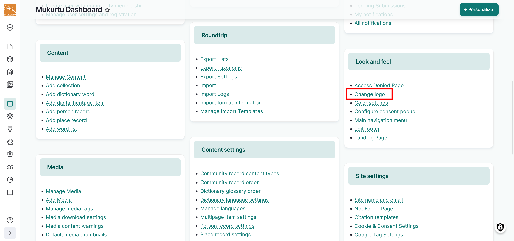
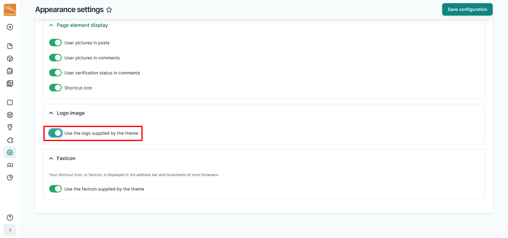
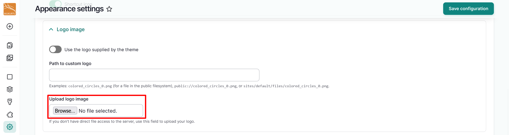
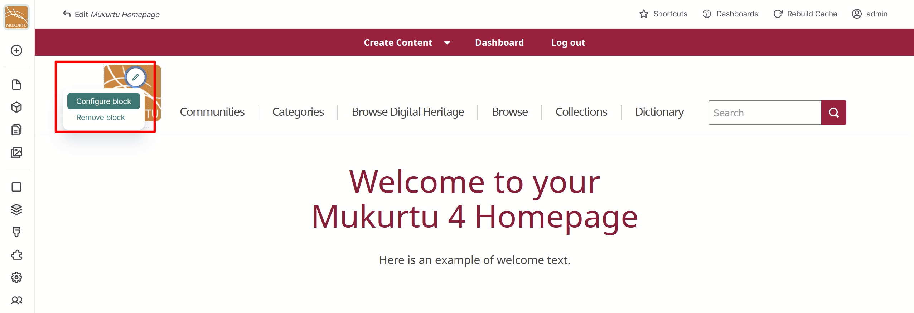
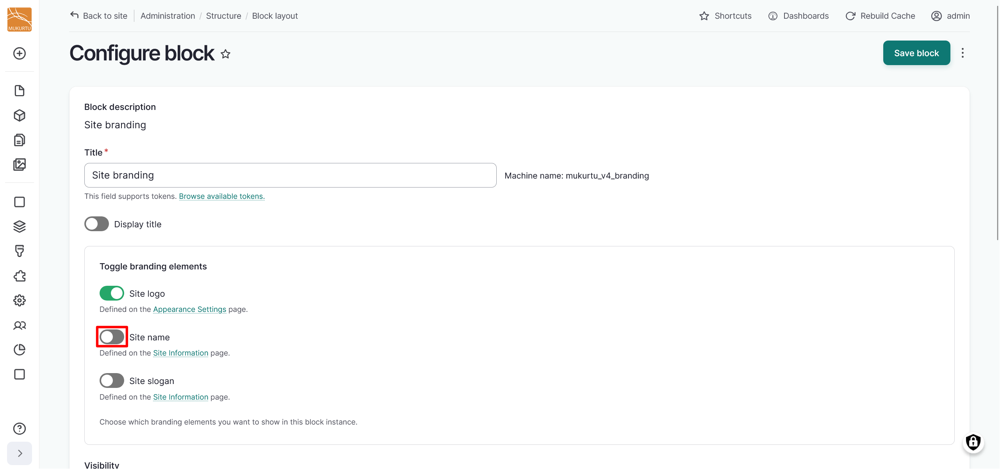
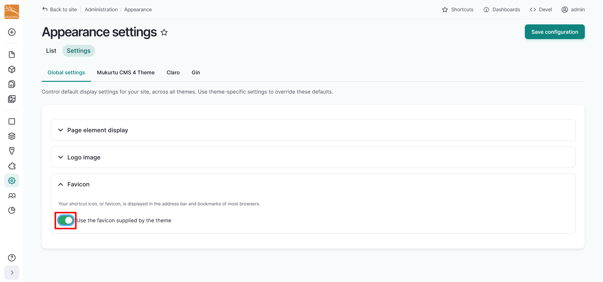
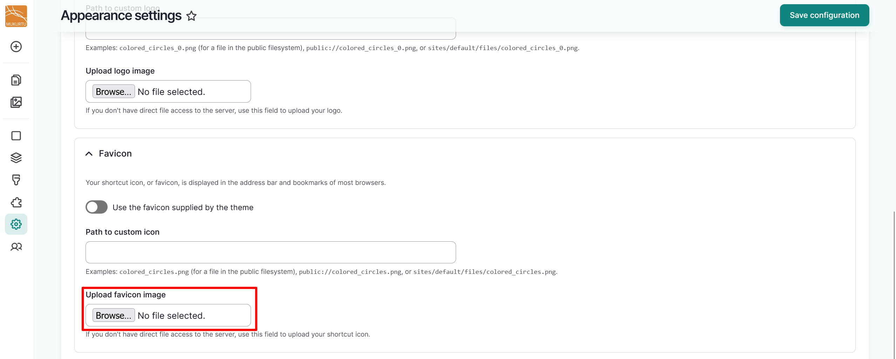
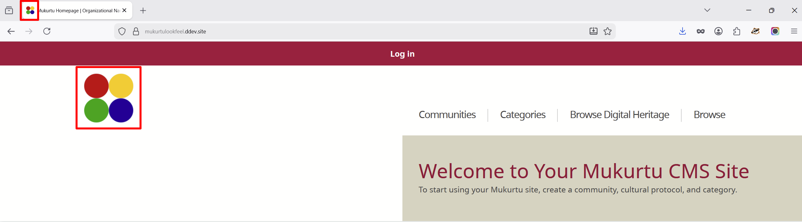

---
tags:
    - getting started
    - look and feel
---

# Configure Site Logos

!!! roles "User roles"
    Administrator, Mukurtu manager

## Configure logo

1. From your **Dashboard**, navigate to the **Look and Feel** section. Select the **Change logo** link, or go directly to `/admin/appearance/settings`.

    

2. Navigate to the **Logo image** section and toggle the slider to the left of the *Use the logo supplied by the theme* field off.

    

3. You can upload your custom logo image by selecting the "Browse" or "Choose File" button. The text of the button depends on your browser settings.

    

4. You can select the "Save configuration" button to save your logo at this point, or you can continue for instructions on how to customize your favicon.

## Use text branding 

You may choose to use text branding in addition to or in place of a logo. To use this feature, navigate to your logo and select the **Edit** icon, then select **Configure block**.

1. Toggle the *Site name* field on. Optionally, you may choose to toggle the *Site logo* off if you want to use text branding.

    

2. Select the "Save block" button in the top right-hand corner of the page.

This will set your site name as the text branding for your site. For instructions on how to configure your site name, navigate to the [Configure Basic Site Settings](../site-settings/index.md)

## Configure your favicon

Your shortcut icon, or favicon, is displayed in the address bar and bookmarks of most browsers.

1. From your **Dashboard**, navigate to the **Look and Feel** section. Select the **Change logo** link, or go directly to `/admin/appearance/settings`.

    

2. Navigate to the **Favicon** section and toggle the slider to the left of the *Use the favicon supplied by the theme* field off.

    

3. You can upload your favicon image by selecting the "Browse" or "Choose File" button. The text of the button depends on your browser settings.

    

4. Select the "Save configuration" button to save your favicon.

