---
tags:
    - getting started
    - look and feel
---

# Configure Landing Page

!!! roles "User roles"
    Administrator, Mukurtu manager

Mukurtu CMS includes a preconfigured landing page layout that users can personalize to reflect their organizational branding. The default layout consists of:

- An easily personalized welcome banner.
- A Featured Content block to showcase any featured content on your site.
- A Mukurtu Categories browse block, featuring all the categories on your site.
- A Browse by Community block, which showcases all the different communities that a user has access to view.
- A Map Browse block, featuring an interactive Leaflet map showcasing the location of the site's content.

Users also have the option to personalize their landing page to reflect their organizational branding and best showcase their content. 

## Edit the default landing page

From the **Dashboard**, navigate to the **Look and Feel** section and select the **Landing Page** link. This takes you to Mukurtu's **Layout Builder** editor for the default landing page. From here you can add or remove sections and blocks. 

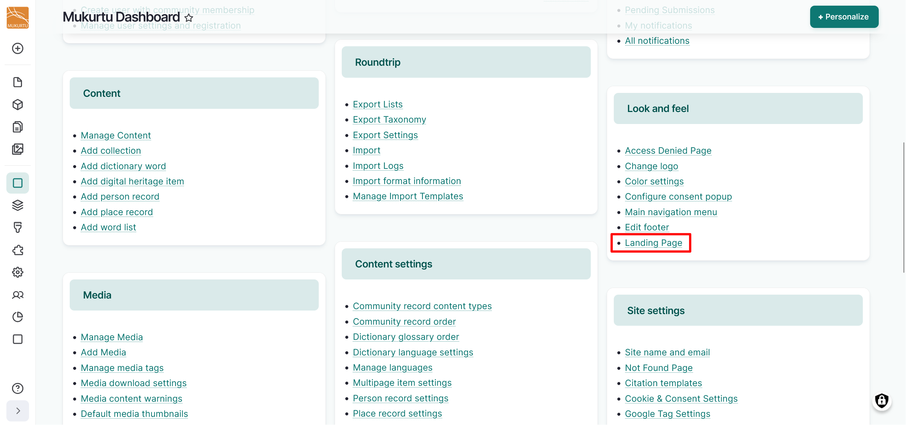

### Configure sections

Sections are the primary regions for your theme. 

#### Add a section

1. To add a new section to your landing page, select the "Add section" button. 

    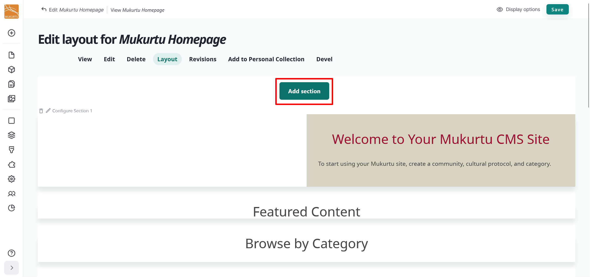

2. Select the "One Column" button in the right-hand **Choose a layout for this section** sidebar.

    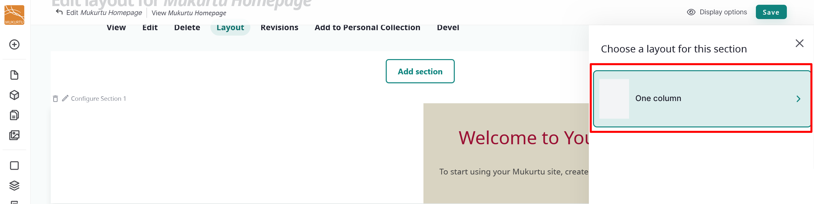

3. Optionally, you can use the *Administrative label* field to add a label for your section, then select "Update". If you choose not to add a label for your section, it will be automatically labelled in the order it appears on the page. Labelling your section can be useful for reference and organization, especially if your sections need to appear in a particular order.

    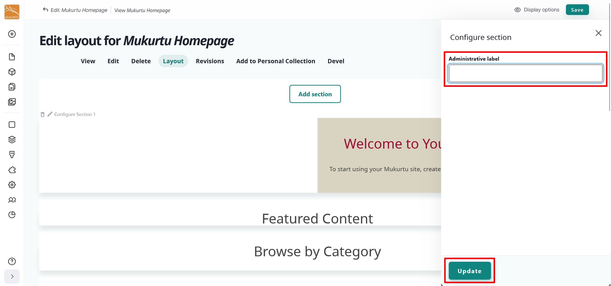

4. You can select "Save" now to save your section, or you can add blocks. For more information about adding blocks, refer to the [Block Types and Configuration](../look-and-feel/ConfigureBlocks.md) article.

    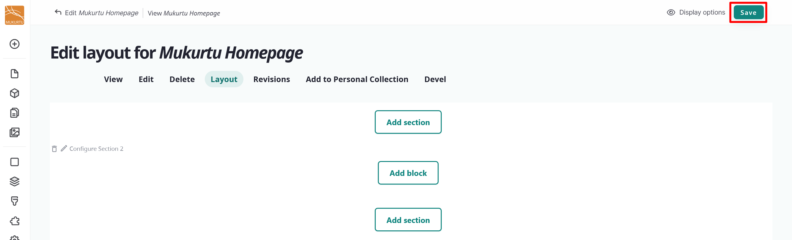

After sections are created they can be rearranged by dragging them to appear in any order on the page.

#### Delete a section

Delete sections by selecting the "Delete" icon. 

!!! warning
    Deleting a section will delete all the blocks within the section.

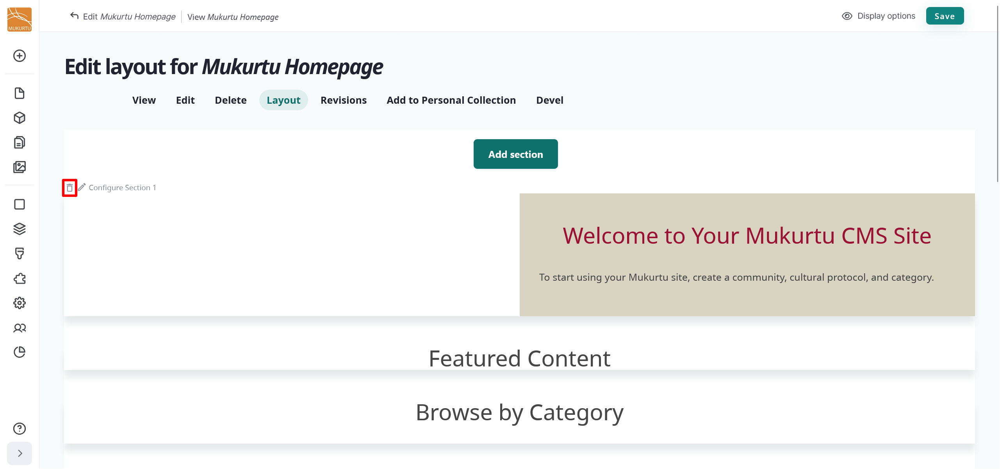

### Add and configure blocks

Blocks are the individual pieces of your site's web layout and are placed within sections. For more information on adding and configuring blocks, refer to [Block Types and Configuration](../look-and-feel/ConfigureBlocks.md).

## Add a new landing page

Most sites will use the provided landing page, but if your landing page has been deleted or you prefer a more personalized landing page, you can add a new default landing page to your Mukurtu site. To add a landing page from the **Admin menu**, navigate to the **Create** section and select the **Landing Page** link.

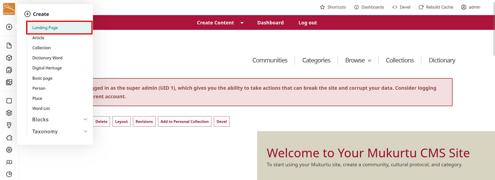

1. Enter a *Title* for your landing page, then select the "Save" button.

    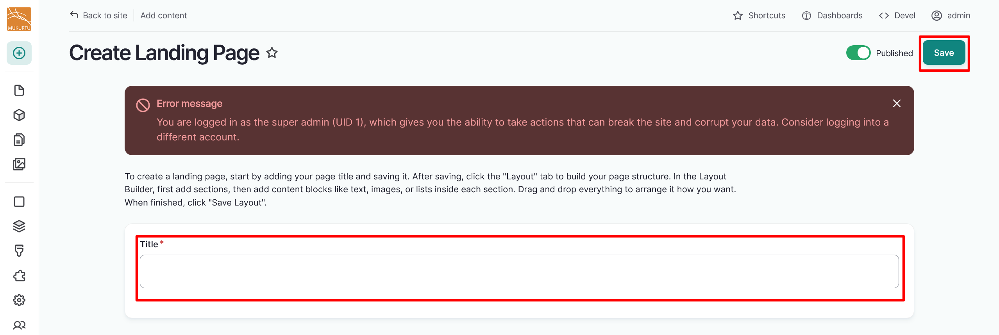

2. This will take you to your new landing page. Select the "Layout" button to add sections and blocks to your landing page. 

    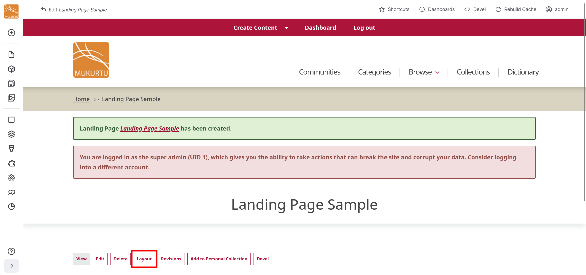

3. Add your sections and blocks. For more information on adding sections and blocks, refer to the [Add a Section](#add-a-section) and [Add a Block](#add-a-block) sections of this article.
4. Select "Save" to save your landing page. 
5. Copy the new landing page extension from your navigation bar. 

    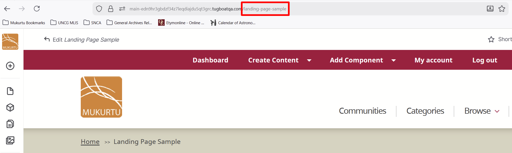

6. Navigate to your **Dashboard**. 
7. From your **Dashboard**, navigate to the **Site settings** section and select the **Site name and email** link.

    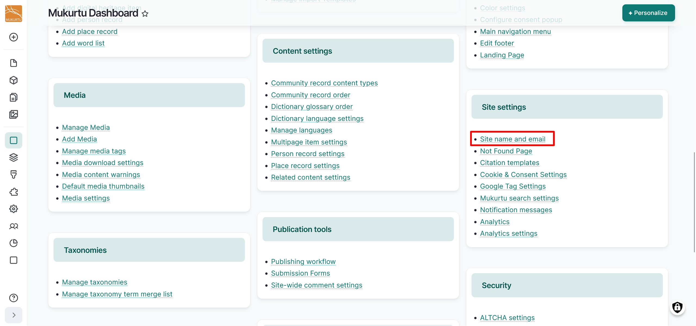

8. Navigate to the **Front page** section and replace the extension in the *Default front page* text box with the extension you copied from your landing page.

    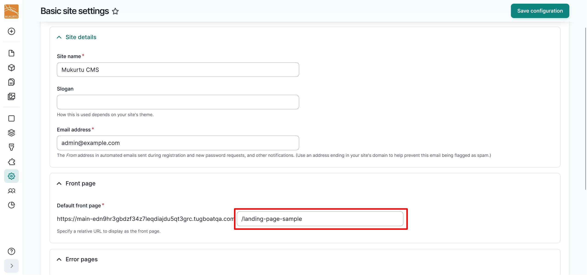

9. Select the "Save configuration" button to apply your changes.

    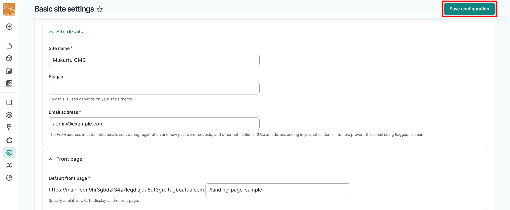

## Configure page background

Users may add an optional page background that is shown behind their home page. When setting a page background, users can also select whether to have light or dark text and whether to tint their background image so that the image competes less with any text on the page. Large images, around 2000 pixels wide, work best for this. If no image is added the page background will be blank.

1. You can upload your page background image by selecting the "Browse" or "Choose File" button. The text of the button depends on your browser settings.

    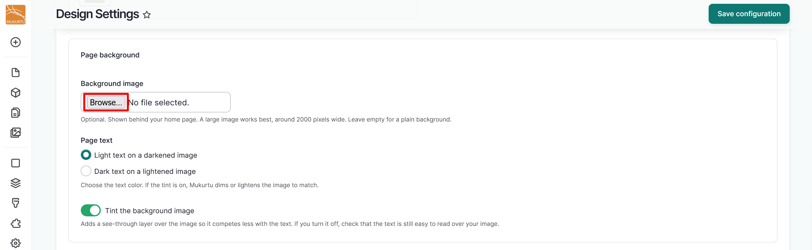

2. Use the **Page text** radio buttons to select your text color. You can select from light or dark text. 

3. *Tint the background image* is selected by default and adds a contrasting transparent layer over your image so it competes less with your text. Use the toggle to turn this setting off.

    !!! tip
        If you turn this setting off, check that the text is still easy to read over your image.

This is an example of a page background with a darkened overlay and light text:

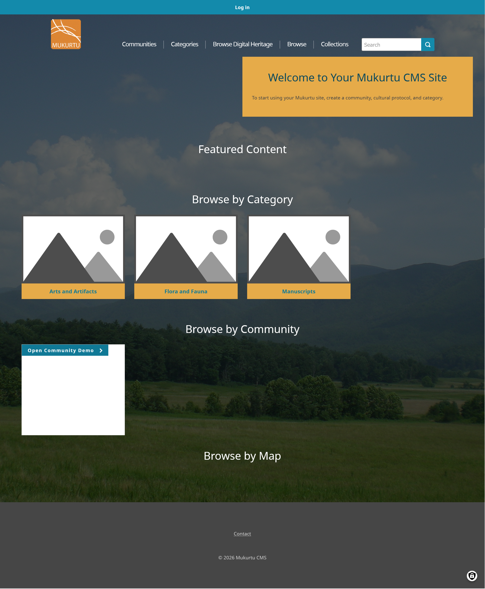

This is an example of a page background with a lightened overlay and dark text:

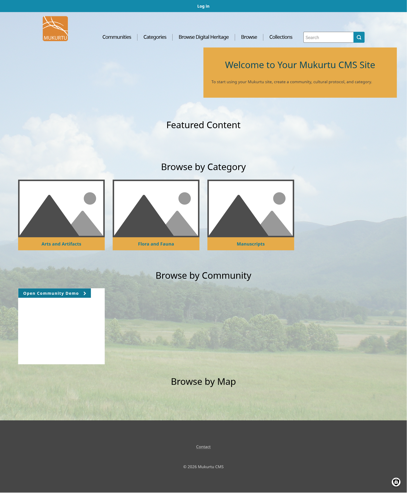

