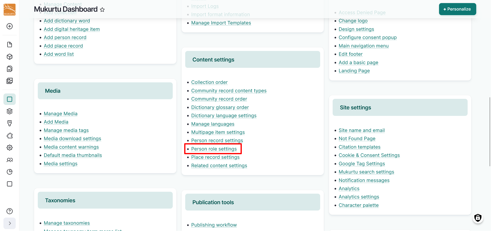
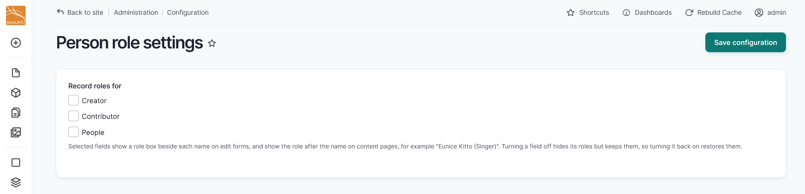
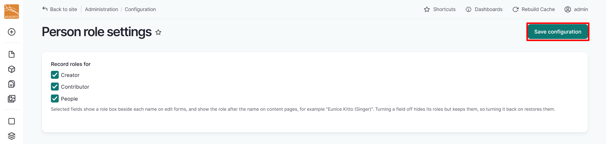

# Configure Person Roles

!!! roles "User role"
    Mukurtu manager

Users can configure selected fields including Creator, Contributor, and People to show a role box beside each name on edit forms, and show the role after the name on content pages. You can choose to turn a field off or on. 
Turning a field off hides its roles but does not delete them, so turning it back on restores them.

## Configure Role Settings

To configure the person roles setting, navigate to your **Dashboard**. 

1. Under **Content Settings** select the **Person Role Settings** link. 

    

2. Select the checkbox to the left of each role show a role box beside each name on edit forms, and show the role after the name on content pages.
 
    

3. Select the "Save configuration" button to save your person role settings.

    

## Apply Roles

1. To apply person roles, navigate to your content form. In a configured *Creator*, *Contributor*, or *People* field, enter the person's name.
2. Select "Enter" or "Tab" on your keyboard.
3. Once the person's name is applied, the *Role* field will appear. Enter an appropriate role for the person.