---
tags:
    - getting started
    - look and feel
---

# Block Types and Configuration

!!! roles "User roles"
    Administrator, Mukurtu manager

## Block types

### Content blocks

- Call to Action: A call to action block enables a block with text and a button that redirects users to a specific site. Calls to action can be used to direct users to specific campaigns or to bring attention to particular aspects of the site.

    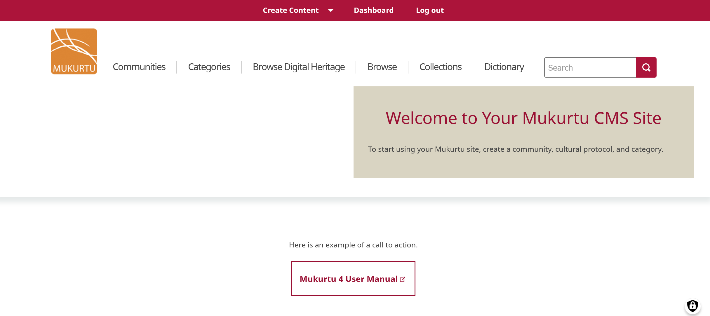

- Featured Content: This block enables users to showcase featured content on their site. For more information on configuring featured content blocks, refer to [Configure a Featured Content block](#configure-featured-content-block).

    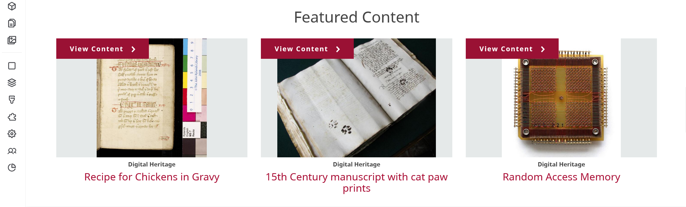

- Full Image With Description: This block features a full-width background image block with overlaid title and description text. For more information on configuring featured content blocks, refer to [Configure a Full Background Block](#featured-content).

    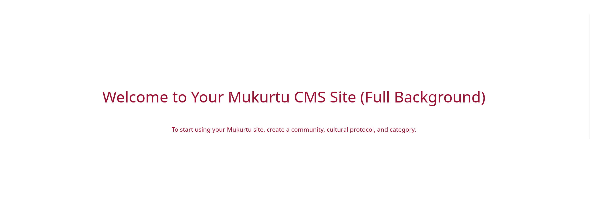

- Horizontal divider: This block adds a grey horizontal divider to your landing page.

    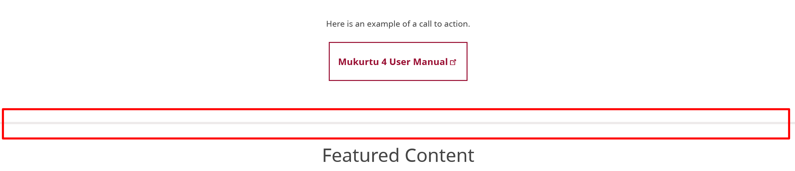

- Image with Description: This block features a half-page, right jusitified welcome banner in our classic Red and Bone color palette. For more information on configuring featured content blocks, refer to [Configure a Welcome Block](#configure-welcome-block-and-vertical-block).

    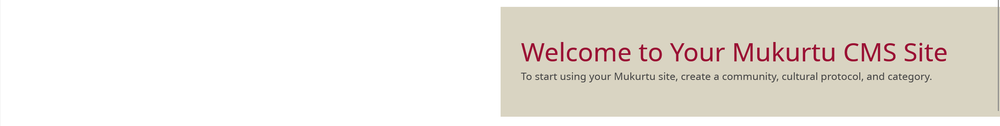

- Local Contexts: This block allows users to feature Local Contexts projects and labels from their site.

- Media assets: This block allows users to feature media assets. Please note, these media assets come from your media library so Cultural Protocols are required. 

- Text: This block adds a formatted text field to the landing page.

- Vertical Image with Description: This block features a single column block with the image on top, followed by title and text below. For more information on configuring featured content blocks, refer to [Configure a Vertical Block](#configure-welcome-block-and-vertical-block).

    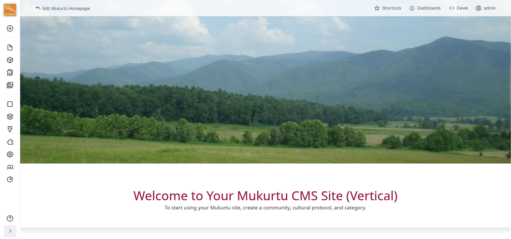

### Lists (Views) blocks

- Browse by Category (names only): This block features all of the categories on your site. This features the categories only by name and does not include a category thumbnail. Categories are automatically added to this block when they are created.

- Browse by Map: Map Block: This block highlights the locations of content using an embedded Leaflet map. Map points are automatically added to this block when they are created.

    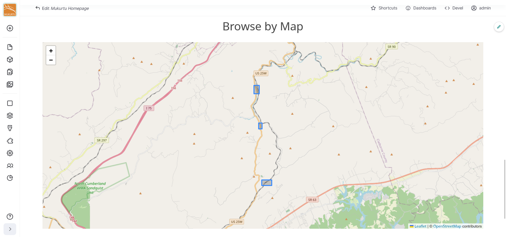

- Mukurtu Categories: This block features all of the categories on your site and includes the category name and thumbnail. If a category thumbnail has not been included, the default category thumbnail will be featured. Categories are automatically added to this block when they are created.

    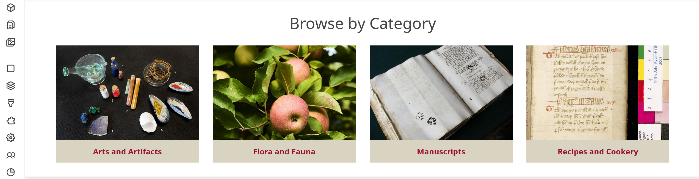

### Mukurtu 

- Browse by Community: This block highlights all the communities on your site that users have permission to view. Communities are automatically added to this block when they are created.

    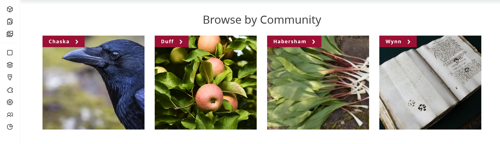

## Configure content blocks

Content blocks include the Call to action, Featured Content, Full Image with Description, Horizontal divider, Image with Description, Local Contexts, Media assets, Text, and Vertical Image with Description blocks. Follow the instructions below to configure your content blocks.

Select the "Edit" icon and then select "Configure" on the blocks you want to configure, or configure new blocks as you add them. 

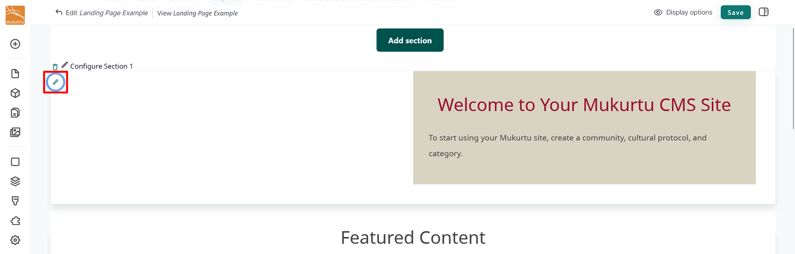

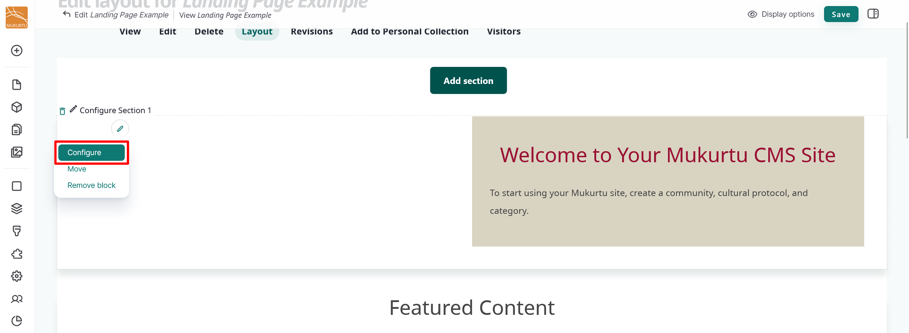

### Call to action 

A call to action block enables a block with text and a button that redirects users to a specific site. Calls to action can be used to direct users to specific campaigns or to bring attention to particular aspects of the site.

1. Add a title in the required *Title* field. You can use the optional **Display title** toggle to configure whether the title is displayed or not.
2. You can use the full text HTML *Text box* to add explanatory text or embedded media.

    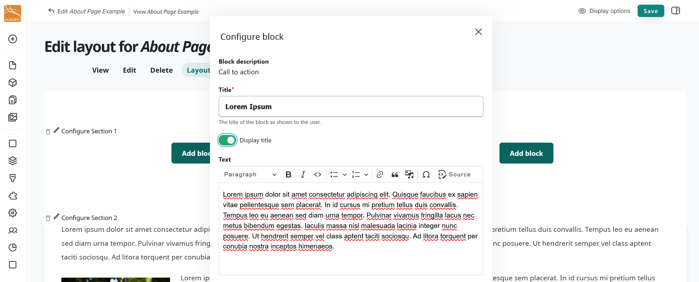

3. Use the *URL* and *link text* fields to include a link.
4. Select the "Add block" button to add your call to action block.

    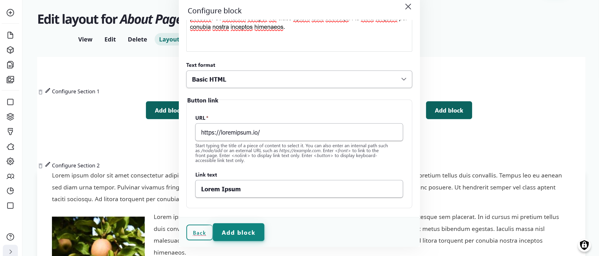

5. You can continue to add blocks, or select the "Save" button in the top right-hand side of the page to save your layout.

    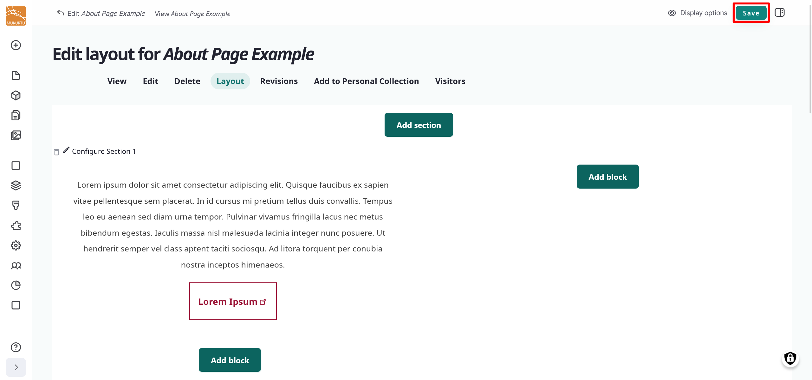

!!! tip
    It is recommended to save your layout as you add blocks in order to avoid losing your work.

### Featured Content

You can add a featured content block to your landing page or your basic page. They are both configured from a particular page, so will not impact any featured content displayed on another page. To add a 

1. Add a title to your featured content block using the *Title* field. Use the **Display title** toggle to choose whether your title is displayed.
2. Select the "Select Content" button to add content to your featured content block.

    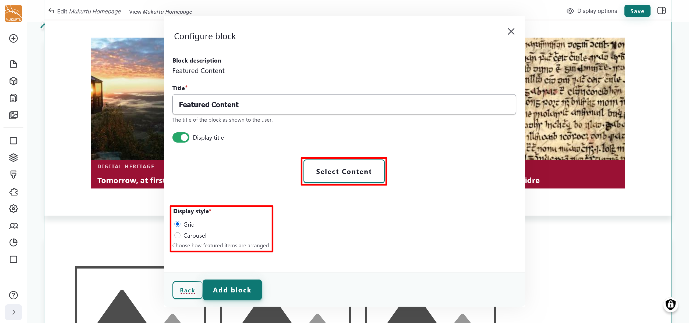

3. Select content to add to your featured content block, then select the "Add content" button to add your content. 
4. Select the "Remove" button to remove any content you do not want included.
5. Select a "Display style" radio button for your block. You can choose to display your block as either a grid or a carousel. 
5. Select the "Add block" button to save your featured content block.

    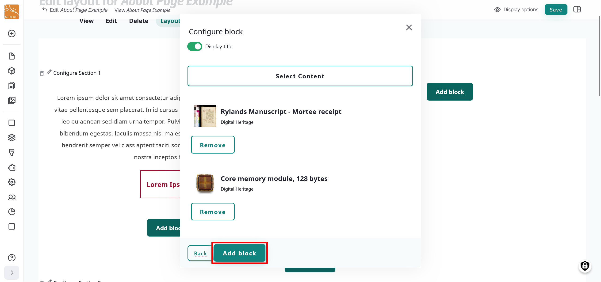

6. You can continue to add blocks, or select the "Save" button in the top right-hand side of the page to save your layout.

    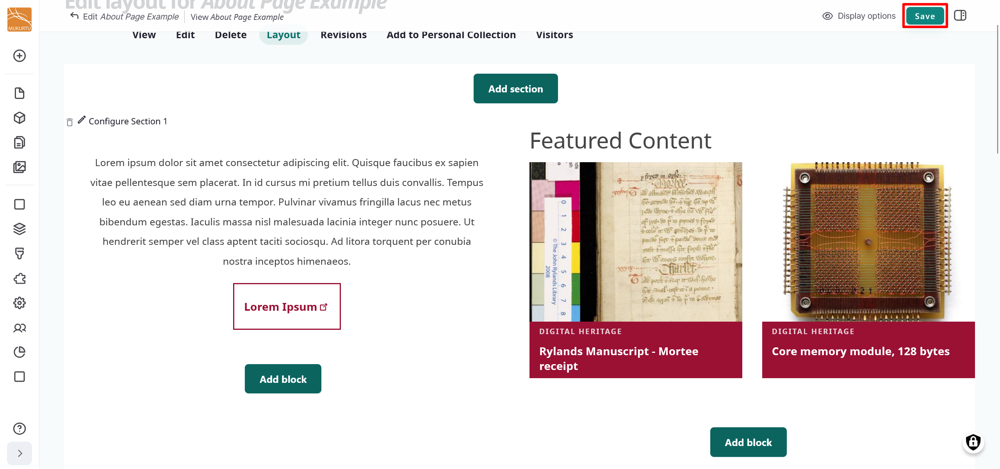

### Configure Full Background block

The Welcome to Your Mukurtu CMS Site (Full Background) welcome block only allows images and requires users to configure the overlaid text color. Follow the instructions to configure your welcome block.

1. Use the *Block description* field to rename your Welcome block.
2. Use the *Body* field to provide more information about your site. 

    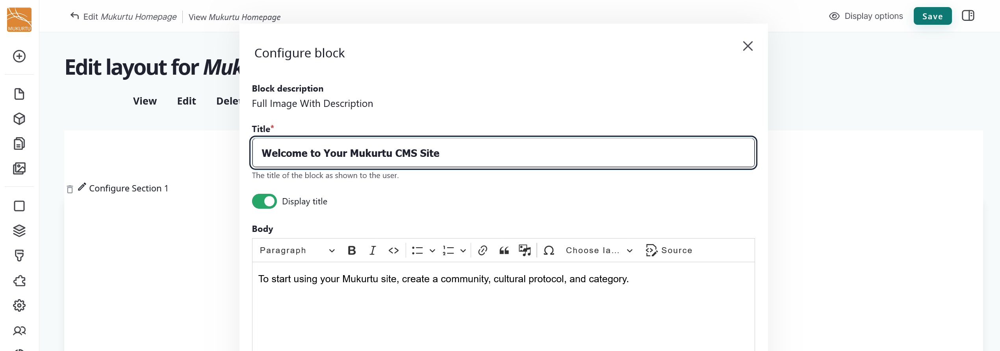

3. Use the "Add media" button to add a background image to your welcome block. For more information on adding media assets, refer to the [Create Media Assets Overview](../media/CreateMediaAssets.md).
4. Select your image, then select the "Insert selected" button.
5. Use the **Text Color** dropdown to select **Light** or **Dark** text. Choose your text color based on background contrast. Light uses white text, Dark uses brand primary dark color. Always verify color contrast meets accessibility standards (WCAG AA minimum 4.5:1 ratio) using an accessibility tool before publishing. 

    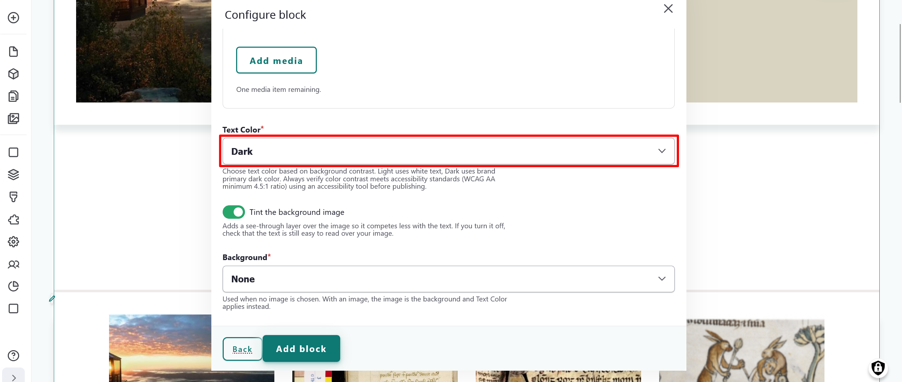

6. Select the "Save" button to save your welcome block.

### Configure Image with description and Vertical image with description blocks

The  Image with Description and Vertical Image with Description welcome blocks are configured the same way, and allow image and video uploads. Follow the instructions to configure your block.

1. Use the *Block description* field to rename your Welcome block.
2. Use the *Body* field to provide more information about your site. 

    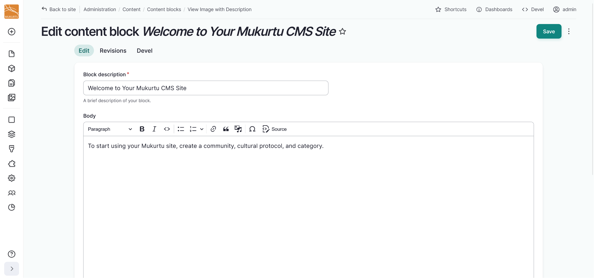

3. Use the "Add media" button to add a media asset to your welcome block. You can add an image or a video. For more information on adding media assets, refer to the [Create Media Assets Overview](../media/CreateMediaAssets.md).

    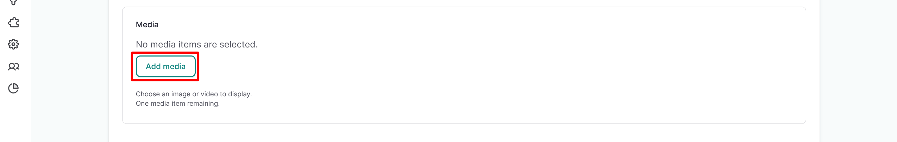

4. Select your media asset, then select the "Insert selected" button.

    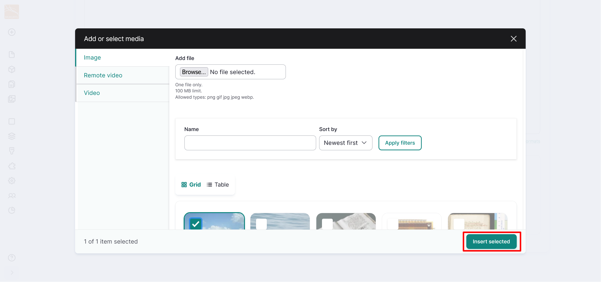

5. Select "Save" to save your welcome block.

### Horizontal divider

You may choose to add a horizontal divider block to your page. Select the **Horizontal divider** link, then select the "Add block" button. 

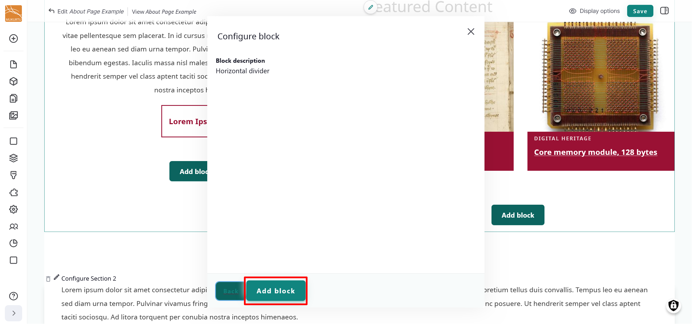

The horizontal divider block is a light grey line that extends the width of one column in your section.

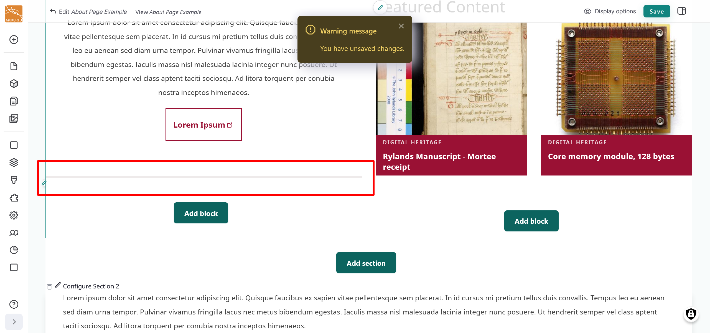

You can continue to add blocks, or select the "Save" button in the top right-hand side of the page to save your layout.

### Local Contexts

To add a Local Contexts labels and notices block, select the **Local Contexts** link. You can add an entire Local Contexts project or individual labels and notices to your block.

1. Add a title to your Local Contexts block using the *Title* field. Use the **Display title** toggle to choose whether your title is displayed.
2. In the **Local Contexts projects** section, use the checkboxes to select projects to add to your block. This will apply all of the labels and notices under the project.
3. In the **Local Contexts labels and notices** section, use the dropdown menu to expand a project. Then use the checkboxes to apply individual labels and notices to your block.

    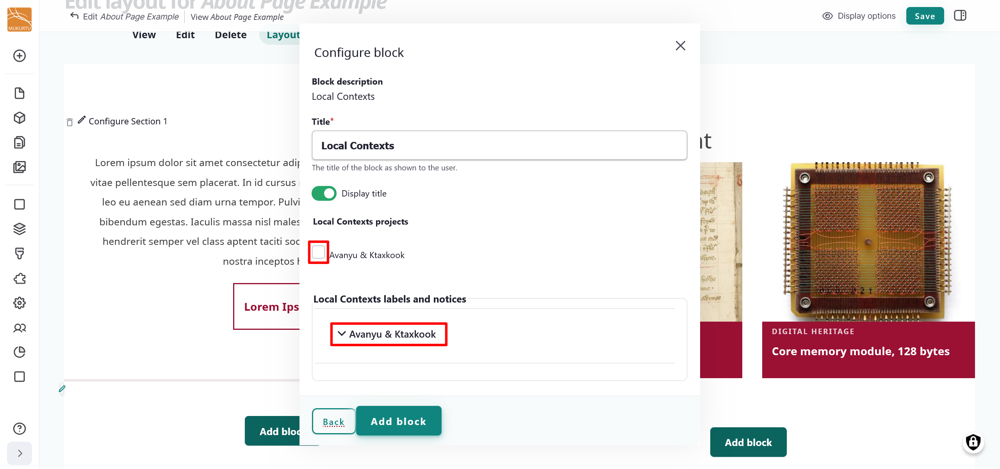

    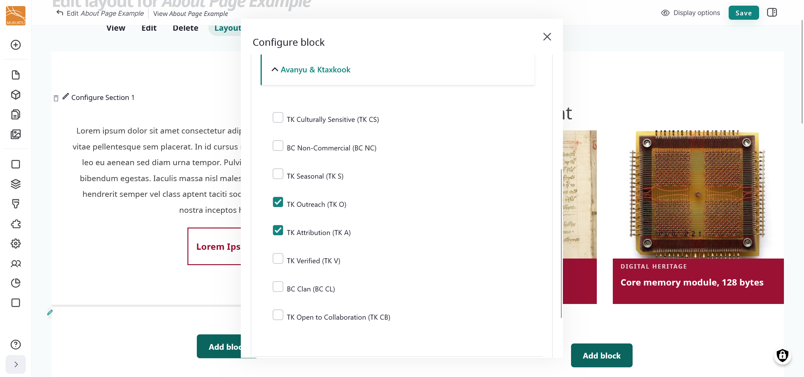

4. Select "Add block" to add your Local Contexts block.
5. You can continue to add blocks, or select the "Save" button in the top right-hand side of the page to save your layout.

    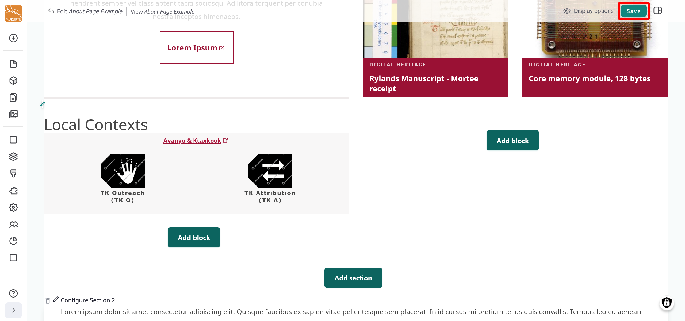

### Media assets

To add a media assets block to your basic page, select the **Media assets** section.

1. Add a title to your Media assets block using the *Title* field. Use the **Display title** toggle to choose whether your title is displayed.
2. In the **Media items** section, select "Add media" to add media assets to your block. Multiple media assets display as a carousel.

    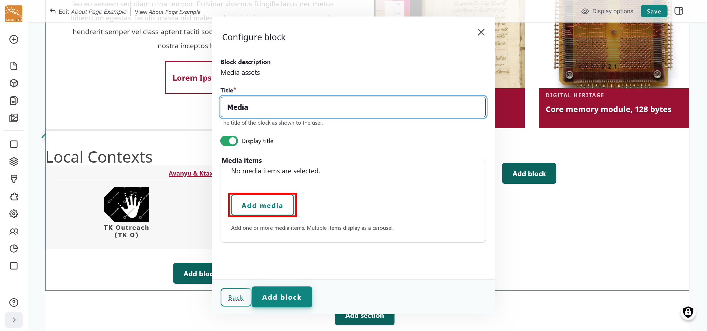

3. Select your media assets using the checkboxes, then select the "Insert selected" button.

    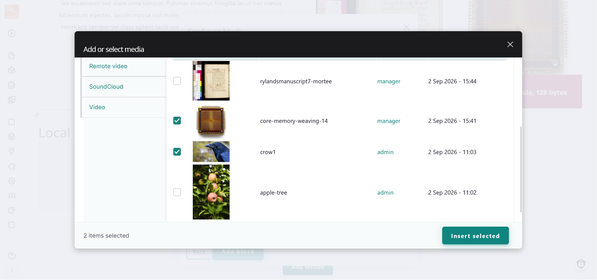
    
4. Select the "Add block" button to add your media asset block.

    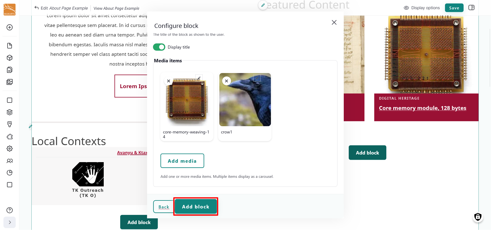

5. You can continue to add blocks, or select the "Save" button in the top right-hand side of the page to save your layout.

### Text

To add a text block to your basic page, select the **Text** section.

1. Add a title to your text block using the *Title* field. Use the **Display title** toggle to choose whether your title is displayed.
2. Use the full text HTML field to add text or embedded media to your block.
3. Select the "Add block" button to add your text block.
4. You can continue to add blocks, or select the "Save" button in the top right-hand side of the page to save your layout.

