---
tags:
    - getting started
    - look and feel
---

# Configure Design Settings

!!! roles "User roles"
    Administrator, Mukurtu manager

## Configure color settings

Mukurtu includes two stock color palettes: Blue and Gold and Red and Bone. There is also an experimental palette customizer that allows you to configure custom colors. You can configure your color palette settings in the **Dashboard** by navigating to **Look and Feel** and selecting the **Design settings** link.

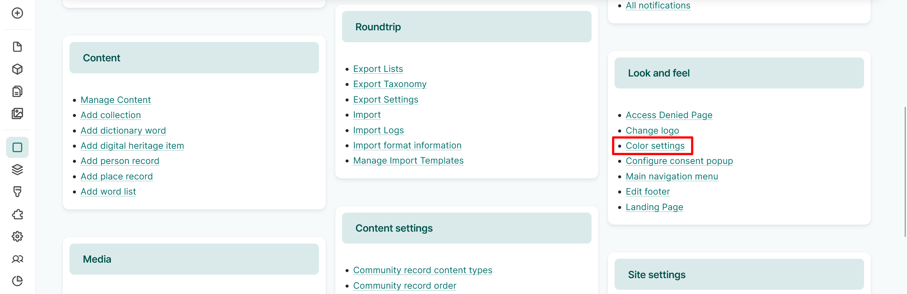

### Select preconfigured colors

1. Select the radio button to the left of the **Blue Gold** or **Red Bone** palette.

    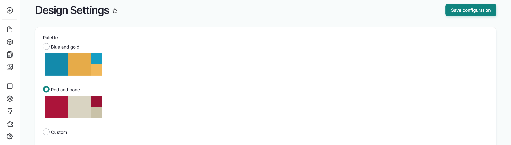

2. Select the "Save" button to apply your color palette site-wide.

    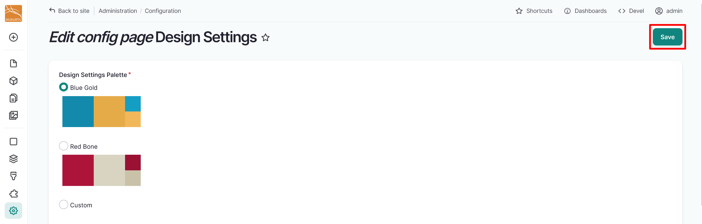

### Configure the custom palette

Please note, this is an experimental tool. Our stock palettes are selected to meet accessibility requirements and custom color selection is not covered by our tests. For more control over the colors, consider implementing a subtheme.

1. Select the **Custom** radio button.

    !!! tip
        Users receive a warning if their selected custom color selection fails accessibility contrast checks.

    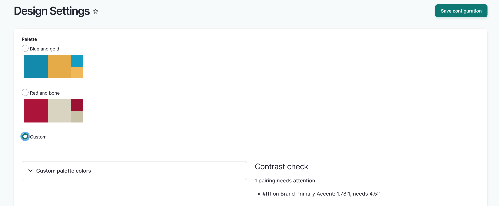

2. Select the color selector for the colors you want to edit. 

    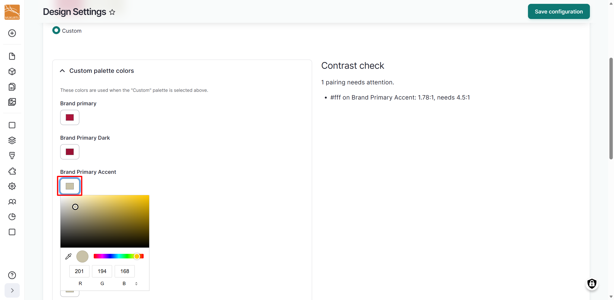

3. Use the modal to select the color you want to apply. You can use *HEX*, *HSL* (*Hue Sat Lum*), or *RGB* (*Red Green Blue*) codes to specify colors. 
4. Select the "Save" button to apply your color palette site-wide.

    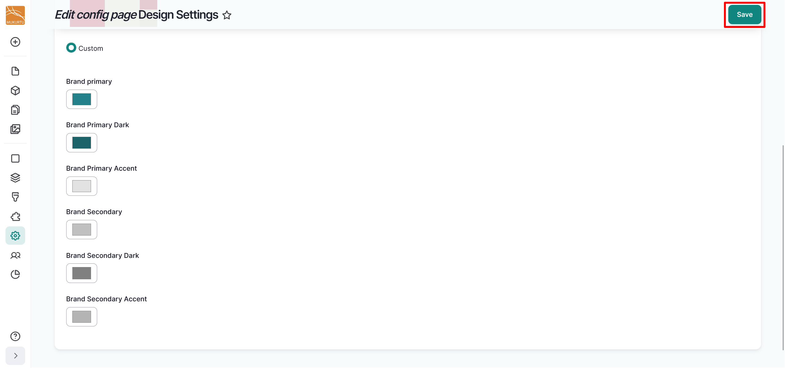

## Configure page background

Users may add an optional page background that is shown behind their home page. When setting a page background, users can also select whether to have light or dark text and whether to tint their background image so that the image competes less with any text on the page. Large images, around 2000 pixels wide, work best for this. If no image is added the page background will be blank.

1. You can upload your page background image by selecting the "Browse" or "Choose File" button. The text of the button depends on your browser settings.

    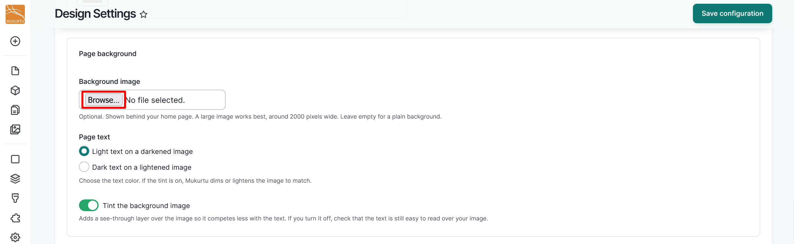

2. Use the **Page text** radio buttons to select your text color. You can select from light or dark text. 

    !!! tip
        *Tint the background image* is selected by default and adds a contrasting transparent layer over your image so it competes less with your text. If you turn this setting off, check that the text is still easy to read over your image.

This is an example of a page background with a darkened overlay and light text:

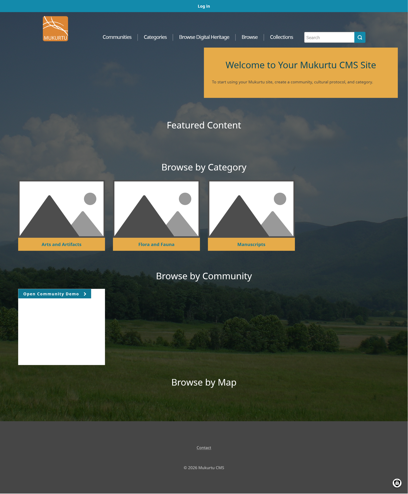

This is an example of a page background with a lightened overlay and dark text:

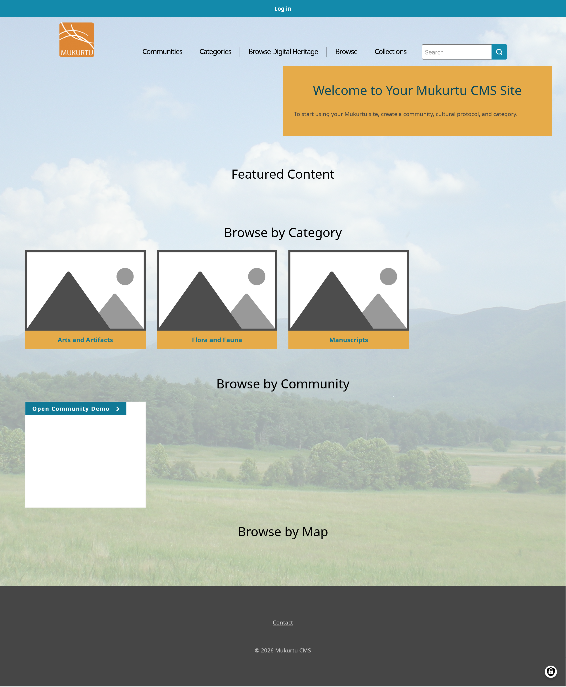

## Configure header background

Users may add an optional header background that is shown behind the logo and menu on every page. A short, wide image is recommended, around 2000 x 300 pixels. 

If your home page has its own background image, that one is used on the home page instead. 

1. You can upload your header background image by selecting the "Browse" or "Choose File" button. The text of the button depends on your browser settings.
2. Use the **Page text** radio buttons to select your text color. You can select from light or dark text. 

    !!! tip
        *Tint the background image* is selected by default and adds a contrasting transparent layer over your image so it competes less with your text. If you turn this setting off, check that the text is still easy to read over your image.

This is an example of a header background with a darkened overlay and light text:

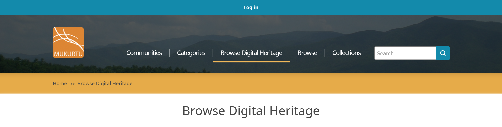

This is an example of a header background with a lightened overlay and dark text:

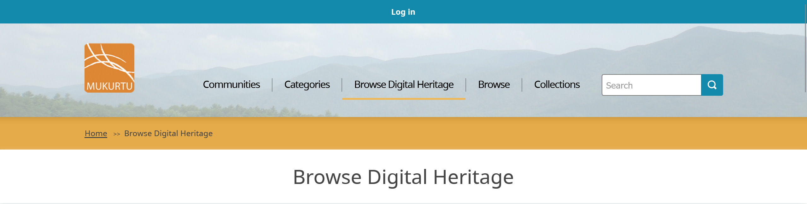