---
tags:
    - getting started
    - look and feel
---

# Create and Edit Basic Pages

!!! roles "User roles"
    Administrator, Mukurtu manager

Basic pages can be used as About pages or as other static pages on your site. Follow the instructions below to create a Basic page.

## Create a basic page

1. From the **Dashboard**, navigate to the **Look and Feel** section and select the **Add a basic page** link.

    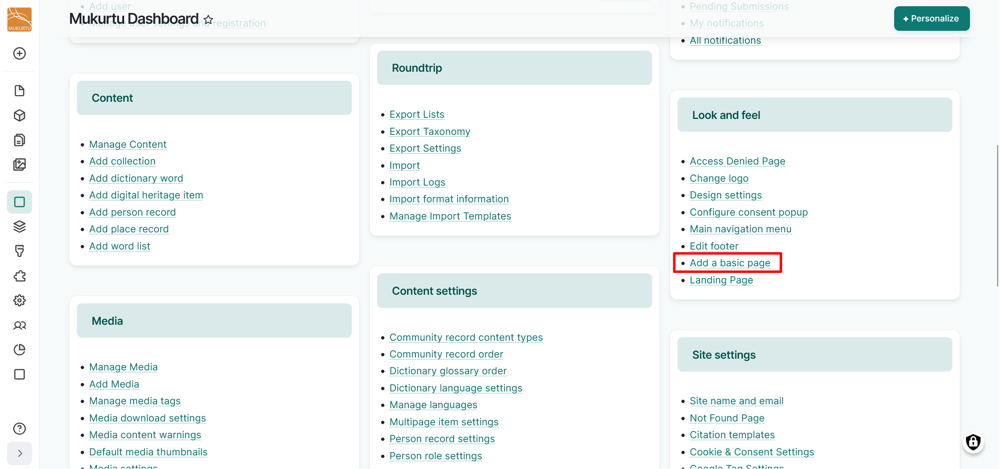

2. Use the *Title* field to enter a title for your basic page. 

    - This is a required field.

3. Enter text or media assets in the *Body* field. This is a full text HTML field that can support images, documents, audio or video recordings, or embeds. To add media, select the "Insert Media" icon from the field's toolbar. Follow the steps in the [Create Media Assets](../media/CreateMediaAssets.md) article to select media assets or to add new media assets to your library.

    !!! tip
        Your site must have at least one Community and Cultural Protocol enabled to add media assets. 
    
    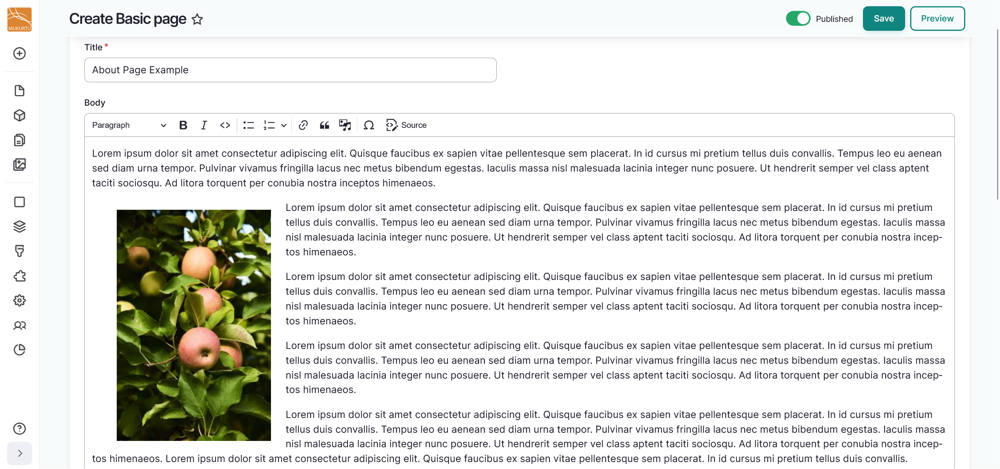

4. Use the **Media Assets** section to add media assets to your basic page. For instructions on how to add a media asset, refer to the [Create Media Assets](../media/CreateMediaAssets.md) article.

    - You can add multiple media assets by selecting more than one media asset from the media modal. 
    - To reorder your media assets, select your media assets and drag them into the order you prefer.

5. Select the "Save" button to save your Basic page.

    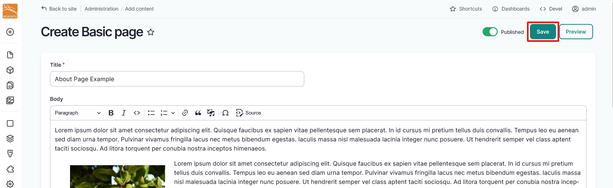

6. Select the "Edit" button to edit your Basic page. After editing, select the "Save" button to save your changes.

## Configure page with Layout Builder

After you create your basic page, you can optionally use the "Layout" button to configure the layout of your basic page with Layout Builder. Navigate to your basic page and select "Layout".

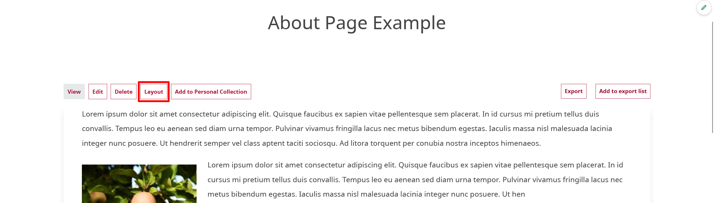

Layout Builder uses sections and blocks to structure the layout of your page. Sections contain blocks, which can include content, dividers, media assets, text, a call to action modal, or Local Contexts labels. 

### Add a section 

1. To add a section, select "Add section".

    !!! tip
        If you add a section to your page without populating it with blocks, the section will not appear on your saved basic page.

2. Sections can be laid out in one, two, three, or four columns. Select your layout for the section.

    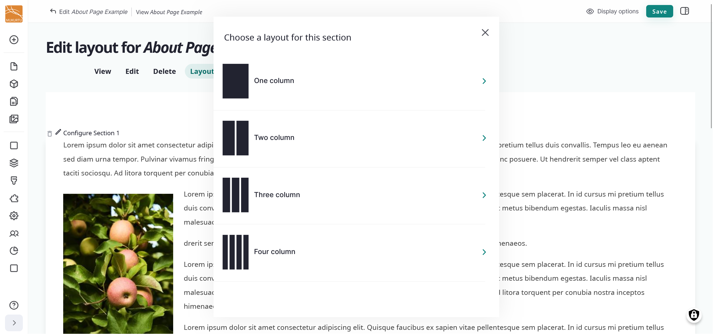

3. Use the *Column widths* dropdown to configure the column widths for your section.

    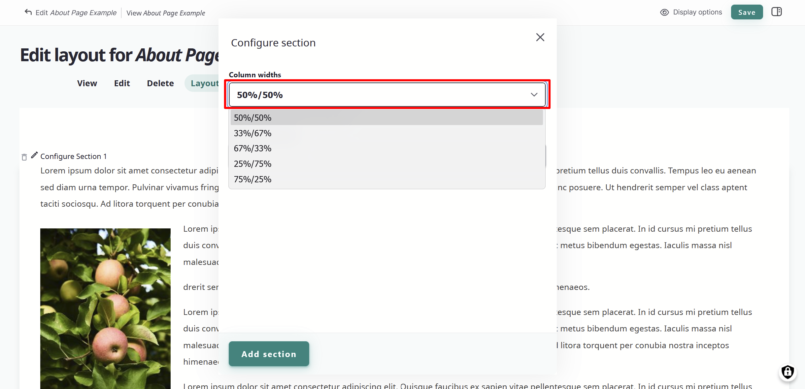

4. Add an optional *Administrative label* to your section. This label will not be visible to end users.

    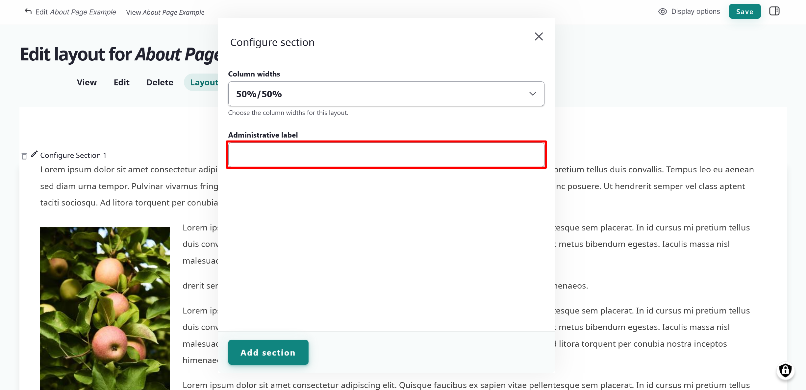

5. Select the "Add section" button to add your section.

    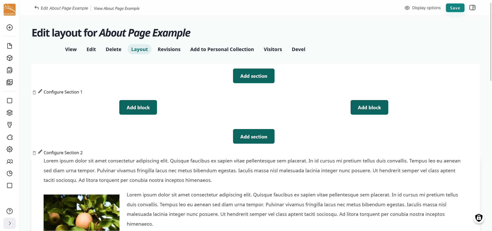

6. Edit or delete your section by selecting the **Edit** or **Delete** icons in the top left-hand side of the section.

    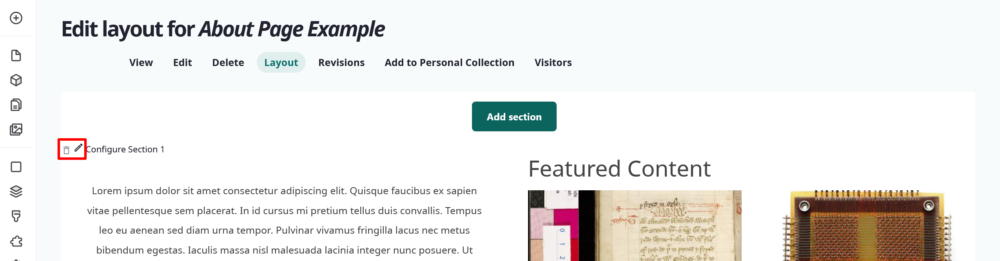

7. Select the "Save" button in the top right-hand corner to save your layout.

### Add blocks

1. To add a block, select "Add block". 
2. Select the type of block you want to add. You can add a Call to action, featured content, horizontal divider, Local Contexts labels and notices, media assets, or a text block.

    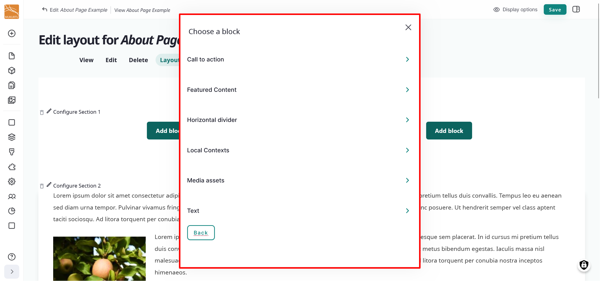

For more information on how to configure the different types of blocks, refer to [Block Types and Configuration](ConfigureBlocks.md)

### Edit basic page

You can edit, move, or remove blocks from your basic page by navigating to the **Layout** tab. 

- To edit a block, select the **Edit** icon in the top left-hand corner of the block, then select the **Configure** option to edit your block.

    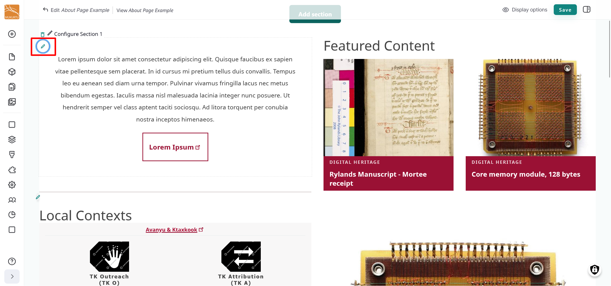

    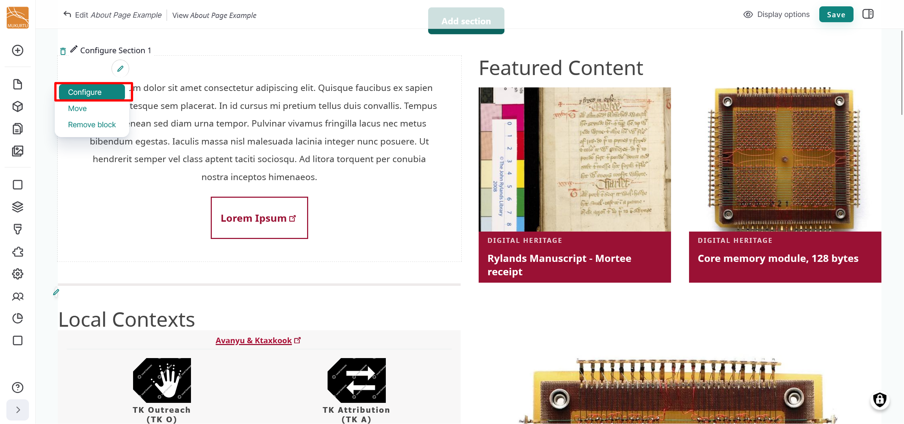

- To move a block, select the **Edit** icon in the top left-hand corner of the block, then select the **Move** option to select and drag your block. You can also select and drag your block using the **Move** icon.

    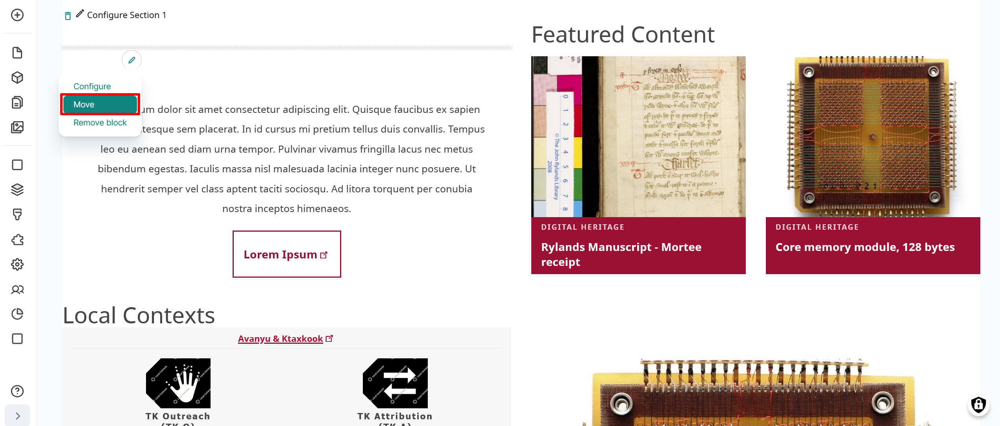

- To delete a block, select the **Edit** icon in the top left-hand corner of the block, then select the **Remove** option. 

    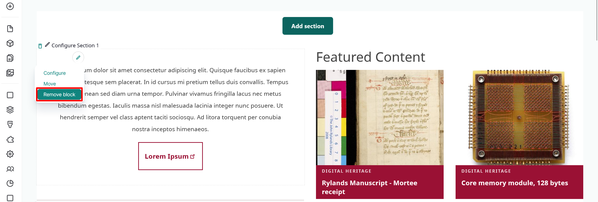

You will receive a confirmation message confirming that you want to remove the block. Select the "Remove" button to finish removing the block.

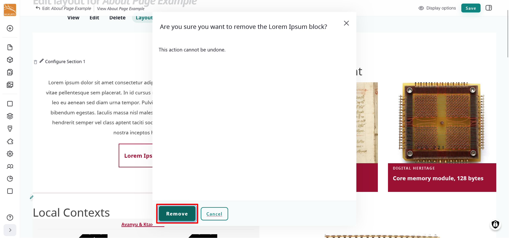

Select the "Save" button in the top right-hand corner of the page to save any changes you make to your basic page layout.

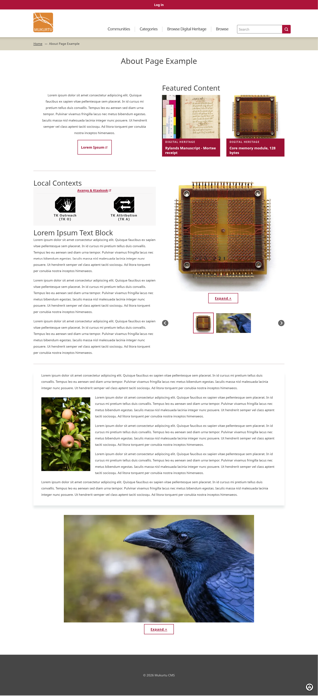