# Exporting Site Data from Reclaim Hosting

To move a Mukurtu 3 site from Reclaim Hosting to another hosting provider, you will need to export the database and the public and private files. 

!!! Note
    If you are using Mukurtu 3 now, and plan to migrate to Mukurtu 4, you should complete the [pre-migration activities](PM02Activities.md) NOW so that you can migrate directly into a new Mukurtu 4 instance. Otherwise you may need to setup Mukurtu 3 on your new hosting provider and then migrate to Mukurtu 4 later.

## Export the database

1) Determine which database you need to export by logging into Reclaim, accessing the cPanel and then selecting “My Apps”.

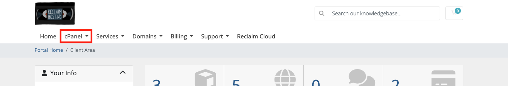

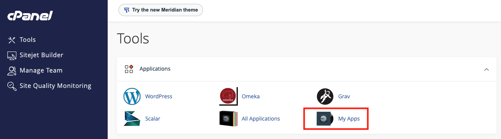

2) Find your Mukurtu instance and select "Edit".

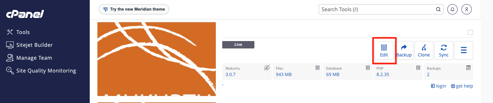

3) Select the settings tab, then "Databases" and note the *Database Name*.

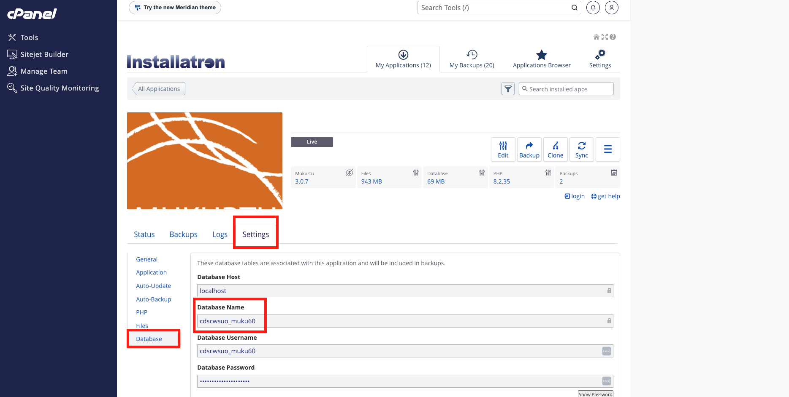

4) Return to the main cPanel menu and find the *Databases section* and select “phpMyAdmin”.

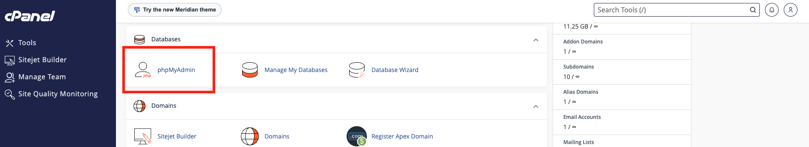

5) In phpMyAdmin, find and select the database name from step 3, select the “export” tab, and "Export Method > Custom".

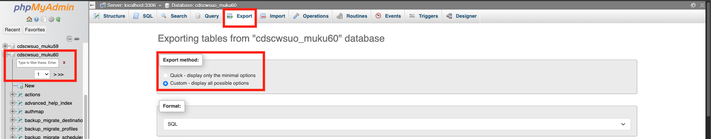

6) Locate the "Object creation options” settings and ensure that “Add DROP TABLE [....]" setting is on.

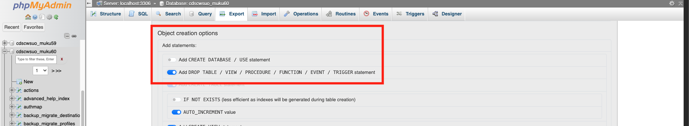

7) Scroll to the end of the page and select “Export”.

8) The file will download with a “.sql” extension. This may take a few minutes to complete.

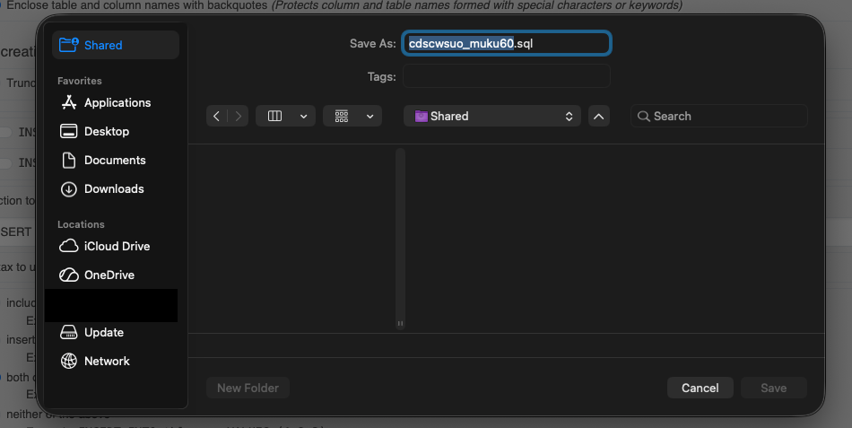

These files can be quite large, to optimize sharing it is a good idea to compress the file:

    - On a Mac, right-click and select “compress”.
    - On Windows, right-click and select “send to” > Compressed (Zipped) Folder. 

 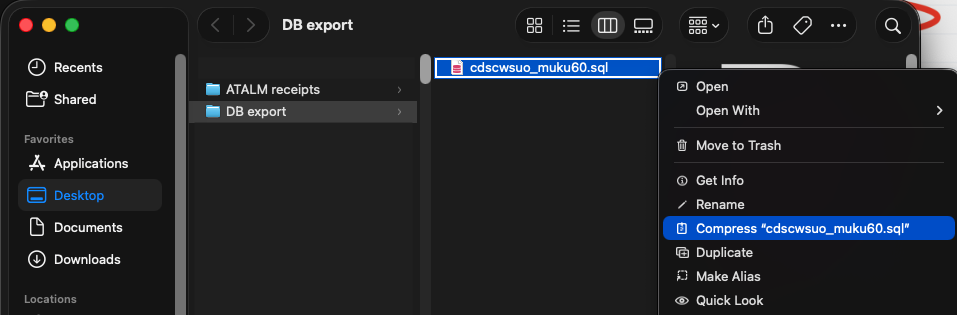

## Download a backup of the site files

1) While logged into your Reclaim account, access the cPanel and then select “My Apps”.

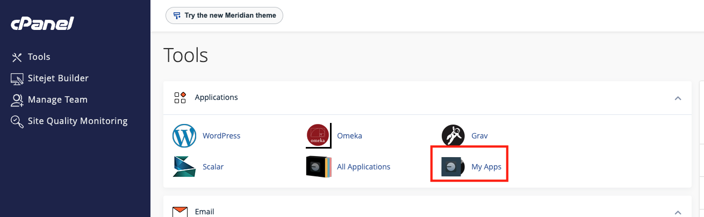

2) Find your Mukurtu instance and select "Backup". We strongly recommend creating a new backup now.

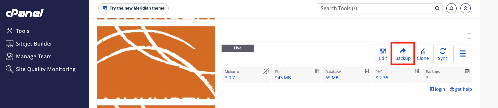

3) Provide an identifiable name for the backup and select "-> Backup". 

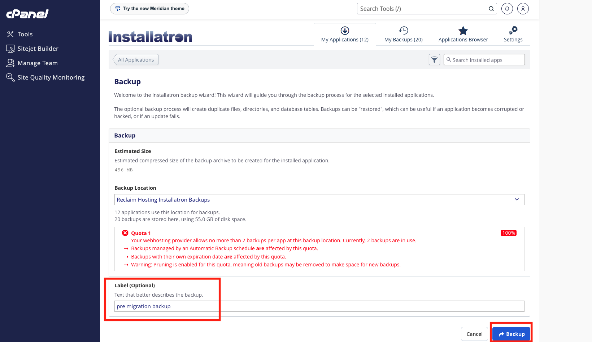

4) A progress bar will be displayed. This may take a few minutes to complete.

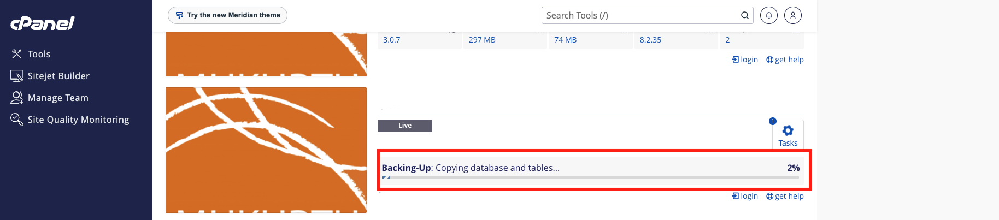

5) When the backup is complete, select "My Backups" at the top of the page.

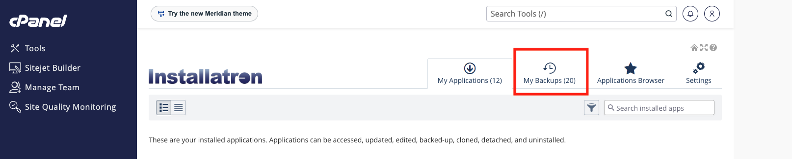

6) Locate the backup you just created and select the "options" icon, then select "Download".

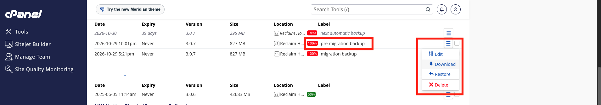

The file will download with a “.tar.gz” extension. This may take a few minutes to complete.

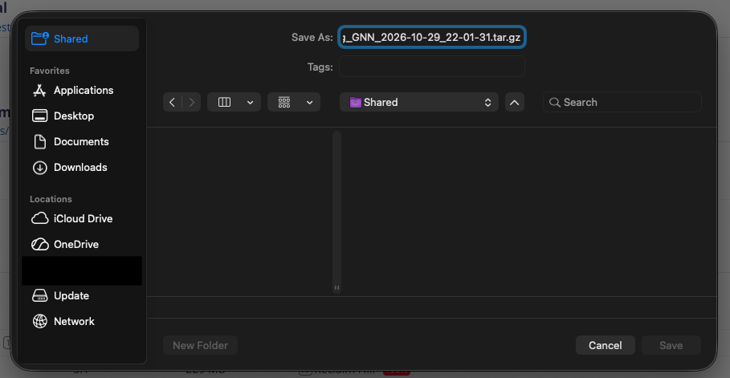
