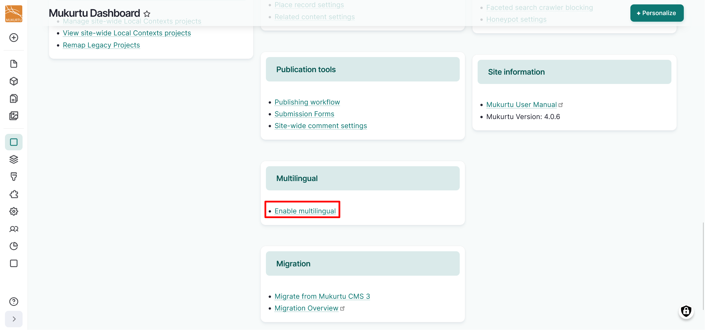
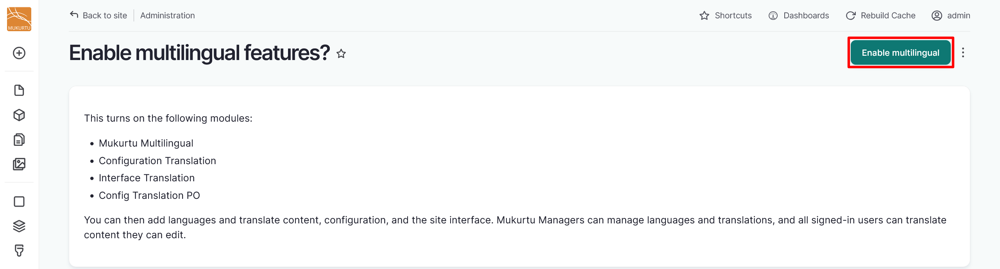
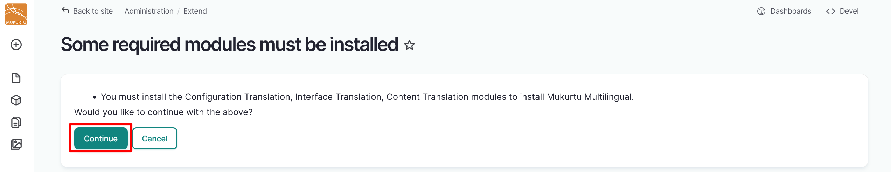
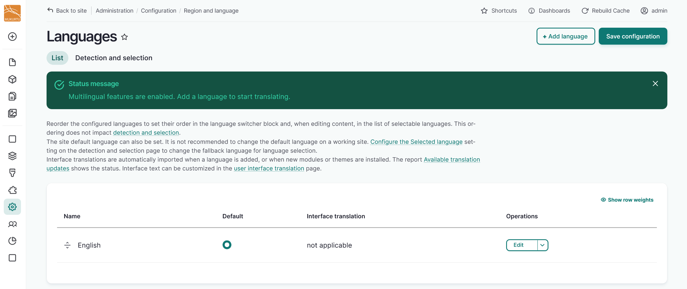
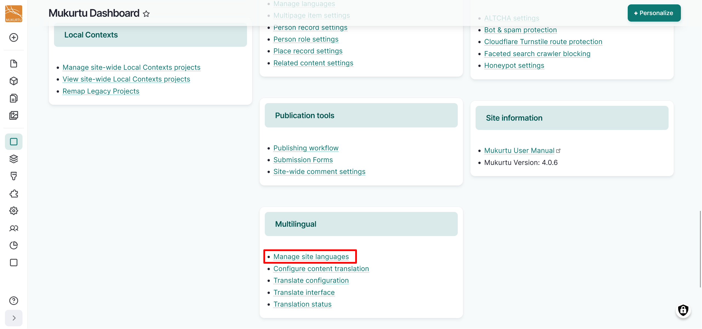
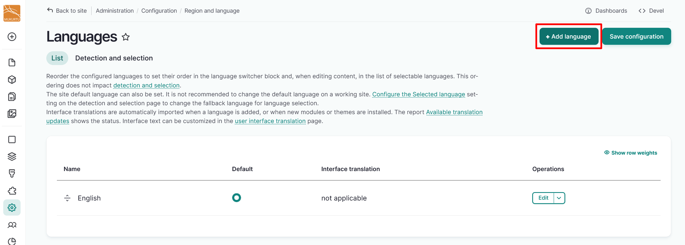
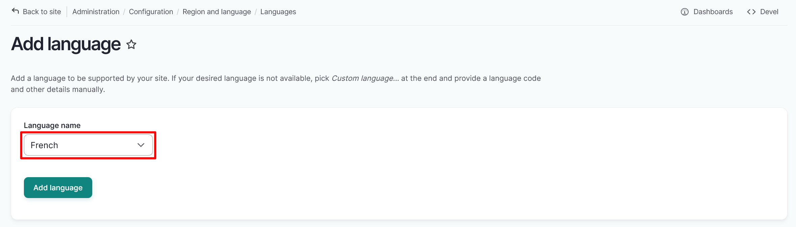
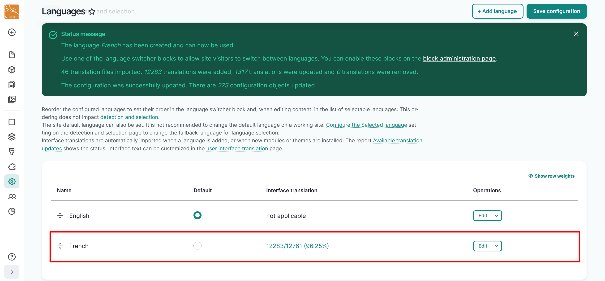
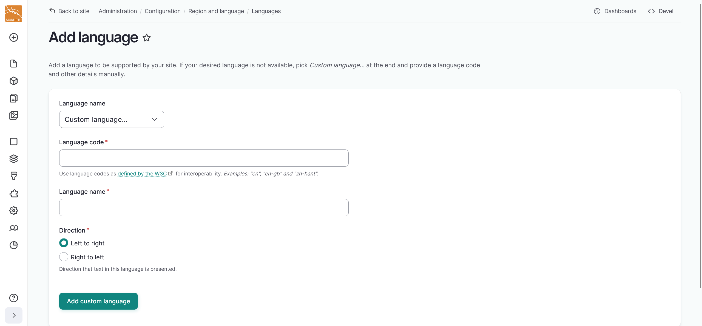

---
tags:
    - multilingual
---

# Enable Multilingual Module

!!! roles "User role"
    Mukurtu manager

The Mukurtu Multilingual module enables the required Drupal multilingual modules (Configuration Translation `/admin/config/regional/config-translation`, Interface Translation `/admin/config/regional/translate`, and Content Translation`/admin/config/regional/content-language`), and configures recommended default settings for most multilingual work. If necessary, these settings can be modified after enabling the Mukurtu Multilingual module. Follow the instructions below to configure your site to display your site's elements and content in multiple languages. 

## Enable module

1. From the **Dashboard**, navigate to the **Multilingual** section and select the **Enable multilingual** link.

    

2. Select the "Enable multilingual" button to installs and configure Mukurtu Multilingual, Configuration Translation, Interface Translation, and Config Translation PO modules.

    

4. You will receive a message asking you to confirm that you want to install all of the associated modules. Select "Continue".

    

5. You will receive a status message confirming that your modules have been installed and redirected to the Languages page. Follow the instructions below to add one or more languages to your site.

    

## Add Languages

You can add your language for translation on the redirected **Languages** page immediately after enabling your multilingual modules. If you choose not to add a language at that time, you can add languages later. From the **Dashboard**, navigate to the **Multilingual** section and select the **Manage site languages** link or go directly by going to `/admin/config/regional/language`. 

### Add a language

1. Select the "Add language" button in the top right-hand corner of the Languages configuration page.

    

2. Select a language from the dropdown menu. If your language is not listed in the dropdown menu, refer to the [Add a custom language code](../multilingual/EnableMultilingualModule.md#add-a-custom-language) section of this article for instructions on how to add your language.

    

3. Select the "Add language" button to add the selected language to your site.
4. You will receive a confirmation message that your language has been added successfully.

    

### Add a custom language

1. If your language is not available, select the "Custom language" option to provide a language code and other details manually. For more information on translating site elements, refer to the [Configuration Translation](../multilingual/ConfigurationTranslation.md) and [User Interface Translation](../multilingual/UITranslation.md) articles.

    - A listing of IANA language tags can be found at the [IANA Language Tags Registry](https://r12a.github.io/app-subtags/) site. 
    - If your language is not listed, you can construct a custom language tag. For more information on constructing custom language tags, visit the [IANA Language Tags Registry](https://www.w3.org/International/articles/language-tags/). 

2. Add your language code in the *Language code* field.
3. Add the name of your language in the *Language name* field. 
4. Select a text direction for your language. 
5. Select the "Add custom language" button to import your language.
        
For more information on language tags and subtags, visit the [IANA Language Tags Registry Primary Language Subtag](https://www.w3.org/International/articles/language-tags/#language) article. For help configuring a custom language tag, please contact Mukurtu Support at [support@mukurtu.org](mailto:support@mukurtu.org).

