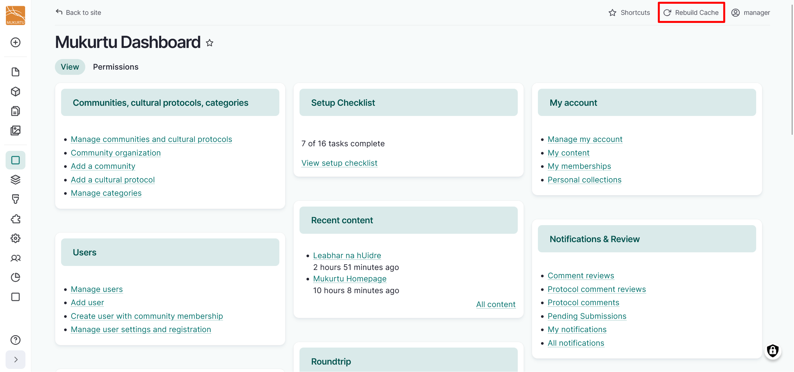
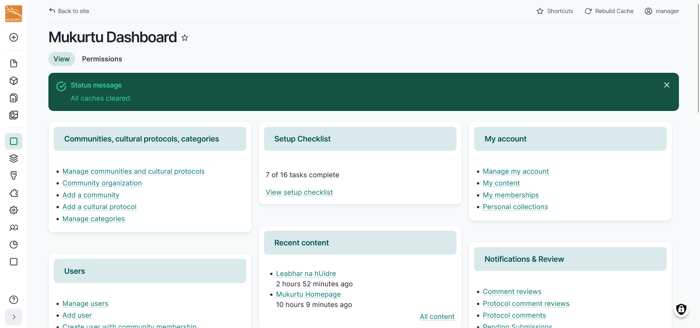

---
tags:
    - site maintenance
---
# Clear Caches

!!! Roles "User roles" 
    Administrator, Mukurtu manager

A common troubleshooting technique is to manually clear Drupal caches. 

As an Administrator or Mukurtu manager in the Drupal menu bar, select the "Rebuild Cache" button.

It may take a few minutes to run. When complete, the page will reload and an “All caches cleared” confirmation message will display.

