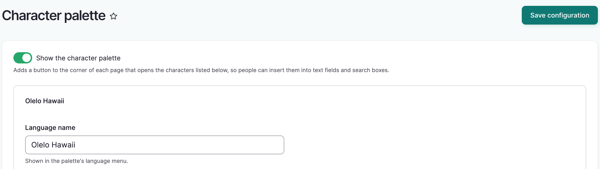
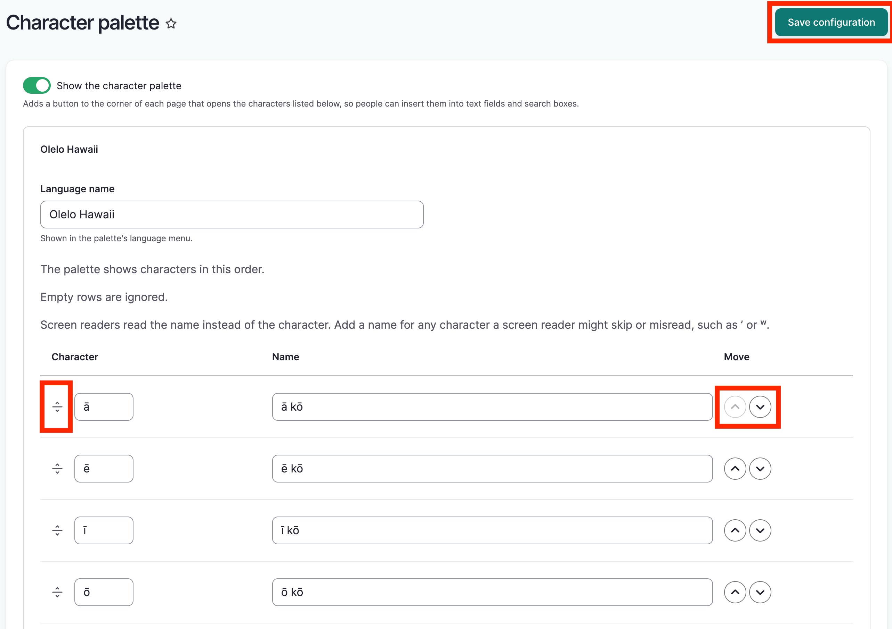
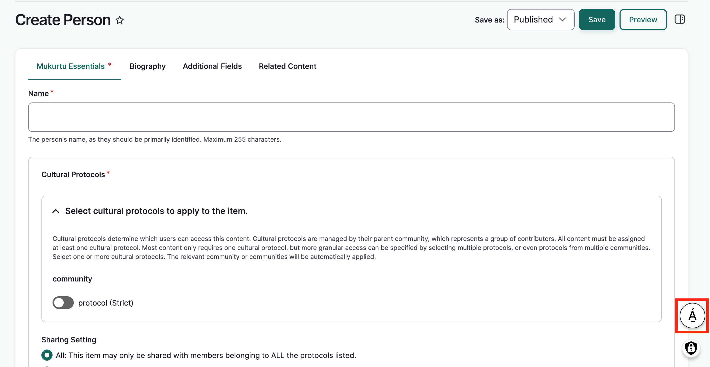
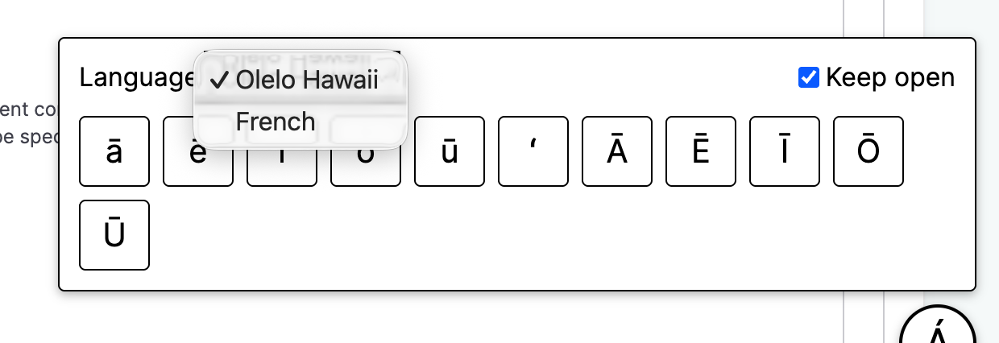

---
tags:
    - site settings
---

# Configure and Use the Character Palette

!!! Roles "User roles" 
    Administrator, Mukurtu manager

The character palette gives users easy access to characters from other language keyboards when editing content without having to install additional keyboards or fonts. The palette is completely customizable, and can display several palettes at once, organized by language. The palette can be hidden and displayed as needed, and users can select from the configured characters and insert them into form fields. It exists independently from site languages.

## Configure the character palette

From the **Dashboard**, under **Site Settings**, select **Character Palette**

1. Toggle **Show character palette** on.

2. Add a language name for your character palette. This will display in the palette's language menu.

    

3. You can now begin to build your palette by adding a character into the **Character** field. Give the character a name. This name will be read by screen readers. Add a name for any character a screen reader might skip or misread. 

    !!! Tip
        Accents that appear with a character must be entered with each character in the character palette. For example, the French grave accent should appear as "è", "à", and "ù" rather than "`"

4. Continue to add characters by selecting "Add new row."

5. Characters can be reordered using the drag and drop arrows to the left, or the keyboard-friendly arrows to the right of each row.

    

6. When you're finished, select "Save Configuration."

After you've saved the first character palette, a new blank form appears below it, and you can add another character palette for a different language.

Delete the palette by selecting "Delete this language" at the bottom of the palette.

## Using the character palette

The character palette will insert characters into text fields, text areas, search boxes, taxonomy fields, rich text editors and map point descriptions. It cannot be used for email, password, URL, number or phone fields. 

On any form where the character palette is available, the character palette will appear as an icon in the bottom right corner.

Select it to open the palette. If you have more than one palette, they will be listed in the language drop-down menu, and you can switch between them. Check the box next to "Keep open" to keep the palette open as you navigate the site. Otherwise it will close every time focus leaves the palette. 

To enter characters from the character palette, simply select the character you need and it will be entered into the field in focus. 
You can use your keyboard and the character palette interchangeably.

!!! Tip
    Use ctrl+shift+space to jump from the field to the character palette. Use tab and shift+tab to navitage the palette, and "enter" to select a character. Ctrl+shift+space returns the cursor to the field.
