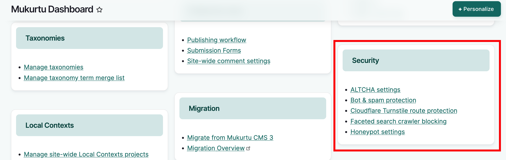
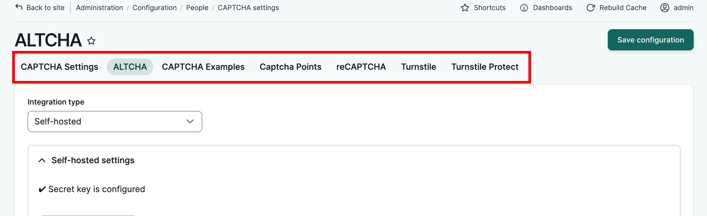
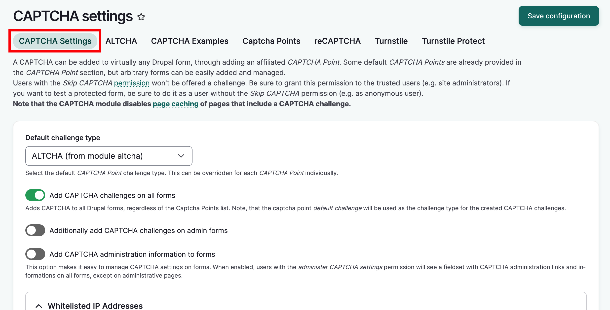
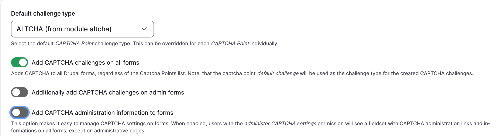
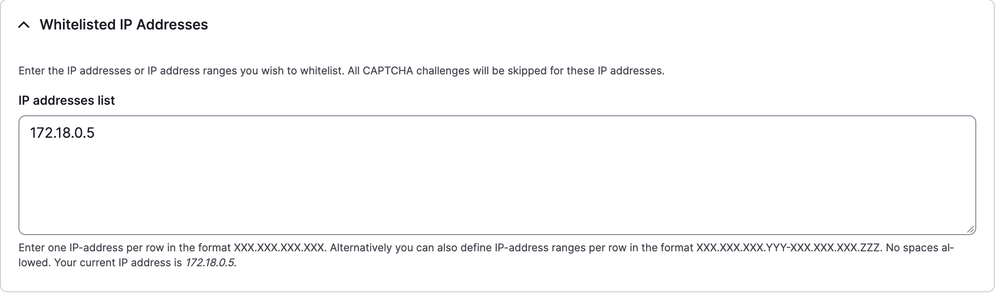
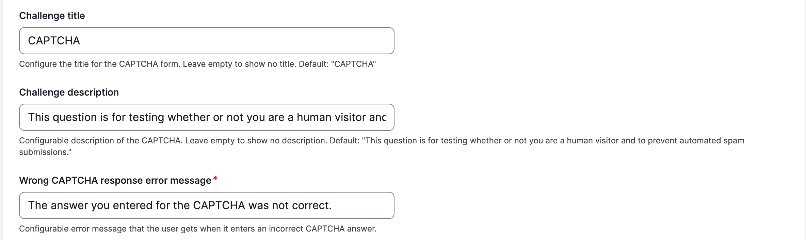
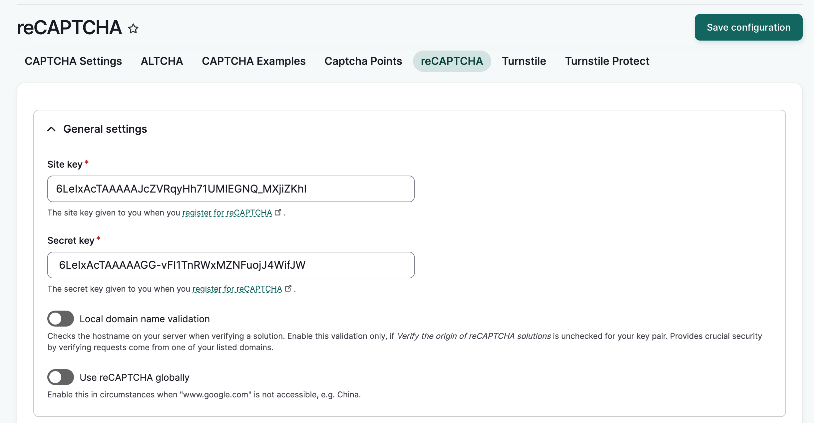
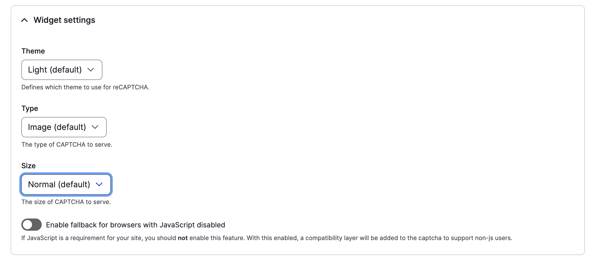
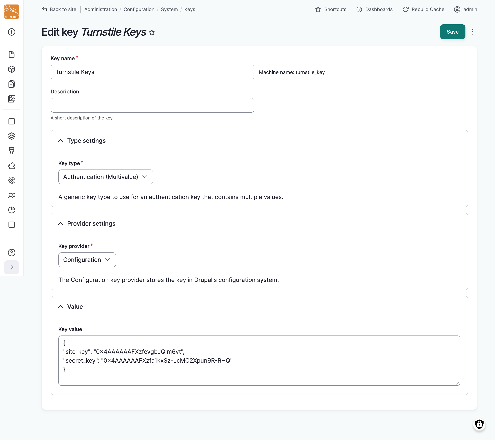
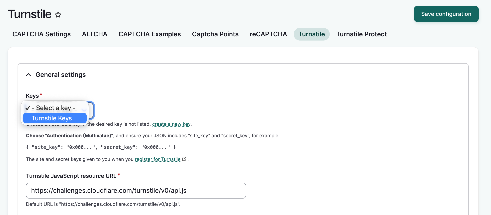

---
tags:
    - site settings
---

# Configure Bot and Spam Protection

!!! Roles "User roles" 
    Administrator, Mukurtu manager

Mukurtu ships with several security modules that can be configured to provide bot protection and spam control. Click on each service to learn more:

 - Basic CAPTCHA - this is built in and can be enabled with no configuration settings.

 - [ALTCHA](https://altcha.org/) 

 - [ReCAPTCHA](https://www.google.com/recaptcha/admin)

 - [Turnstile](https://cloudflare.com/)

By default an ALTCHA checkbox is enabled to provide basic protection, but you can configure any or all of these services, select a default module for all forms, or have certain modules active on certain forms. You can also grant trusted users permissions to automatically bypass security modules. In most cases, configuring just one service will suffice. 

The chart below offers a basic comparison of each CAPTCHA service.

|  | Requires Account | Auto-verification | Manual Challenge |
|---|---|---|---|
| ALTCHA |  | x | x |
| ReCAPTCHA | x |  | x |
| Turnstile | x | x |  |

Settings for these modules can be accessed in the **Security** section of the **Dashboard**



Select **ALTCHA settings** in the **Dashboard**. This takes you to the CAPTCHA settings page, where you can configure the security module of your choice. These settings can be accessed by selecting the appropriate tab at the top of the page.



## Configure CAPTCHA settings

The settings on the CAPTCHA Settings tab dictate how the default security module works on your site. You can choose a default challenge type, decide where challenges will appear (and not appear), customize text, determine challenge behavior and enable tracking and logs.



### Default challenge type

Select a default challenge type from the dropdown menu. This is the challenge that will appear in forms if no other customizations have been made. Options include:

 - ALTCHA 
 - Math 
 - ReCAPTCHA 
 - Turnstile

 Note that ReCAPTCHA and Turnstile modules will need to be configured for this setting to take effect.

 Below this, select where you would like the challenge widget to display. Enabling "Add Captcha challenges on all forms" reveals additional options that allow you to add CAPTCHA challenges and additional information on admin forms and pages. 

 

**Override the default challenge type**

 If there are forms to which you'd like to apply a different widget, you can override the default challenge type by selecting the Captcha Points tab.

 Select **Add Captcha Point**
 Add the ID of the form to which you want to override the default widget.

 Select the widget you want to use and select **Save**.

 ### Whitelist IP addresses

 You may trust users from a certain IP address (such as your organization) that can safely bypass CAPTCHA widgets. You can configure that by listing their IP address here.



### CAPTCHA placement caching

CAPTCHA form placement is cached for efficiency. In some instances, the CAPTCHA form structure may change, and clearing the CAPTCHA placement cache can be required to fix the CAPTCHA placement.

### Text Display

The remaining settings allow you to customize text display and widget behavior. You can change the **Title**, **Challenge description**, and the **Wrong CAPTCHA response error message**.  



### Default validation and persistence 

**Default CAPTCHA validation** determines whether validation should be case sensitive. Select one of:

 - Case sensitive validation: the response has to exactly match the solution. 
 - Case insensitive validation: lowercase/uppercase errors are ignored.

**Persistence** defenes whether challenges should be omitted during the rest of a session once the user successfully responds to a challenge. Select one of:

 - Always add a challenge.
 - Omit challenges in a multi-step/preview workflow once the user successfully responds to a challenge. This is selected by default.
 - Omit challenges on a form type once the user successfully responds to a challenge on a form of that type.
 - Omit challenges on all forms once the user successfully responds to any challenge on the site.

### Logs

Finally, you can enable statitics. CAPTCHA related counters are recorded at `/admin/reports/status`.

You can also enable logging for incorrect responses, which are stored at `/admin/reports/dblog`. 

## Configure a security module

### Configure ALTCHA 

 To configure ALTCHA, from the **ALTCHA** tab, select an integration type. Self-hosted is recommended and selected by default. The other types (Sentinel and Saas) require API keys that require accounts to obtain. 

Generate a key - ALTCHA uses keys to check for bots. This is not the same as an API key. If you've experienced security compromises or change in personnel running the site, you may want to regenerate the key, which can also be done here.

Under **Advanced Settings**, under *Auto Verification* you can turn on auto verification by selecting an event from the dropdown. This means that even if a widget(such as a check box) is visible, users wonʻt have to interact with it. Verification happens automatically when the event youʻve chose takes place. Events include:

 - On page load - this verifies the user when the page loads
 - On form focus - this verifies the user when they start to fill out a form.
 - On form submit - this verifies the user when they submit a form. 

Under **Widget Settings** you can customize the widget by enabling invisible captcha, adjusting behavior and display.

- **Enable invisible captcha** - This does not completely hide the captcha widget, but displays a small floating checkbox challenge. If you have auto verification turned on, the widget will briefly display when your selected even occurs, the box will be checked automatically, disappear, and you can submit your form. 

- **Floating Mode** - Choose where you want the floating widget to sit - above or below the submit button. "Auto" places the wigdget below the submit button.

- **Floating offset** - Use this field to move the widget closer or further away from the submit button.

### Configure ReCAPTCHA

To configure ReCAPTCHA, in the ReCAPTCHA tab, add your Site Key and Secret key generated from your account. 



You can then add light customizations to the widget. Choose a light or dark theme, an image or audio based challenge, and a normal or compact widget size.



### Configure Turnstile

Register for [Turnstile](https://www.cloudflare.com/) and [create a new Turnstile widget](https://developers.cloudflare.com/turnstile/get-started/widget-management/dashboard/). Copy your site key and secret key into this code snippet:

```
{
"site_key": "YOUR-SITE-KEY",
"secret_key": "YOUR-SECRET-KEY"
}
```  

Go to `/admin/config/system/keys/add' to create a new key.



Add a **key name** and optional **description**.

Select the **key type**: "Authentication (Multivalue)"

In the **key value** field, add the code snippet with your site and secret keys. Select **Save**.

Return to the Turnstile settings at `admin/config/people/captcha/turnstile.'

Under **Keys**, the key you just created should be listed in the dropdown menu. Select it.



Now you can customize the widget settings:

 - **Theme** - Choose light, dark, or auto.

 - **Language** - Choose the display language. You can choose between "auto" and the user's chosen language.

 - **Size** - Choose between "Normal," "Compact," and "Flexible."

 - **Retry** - This controls whether the widget should automatically retry to obtain a token if it did not succeed. The default is auto, which will retry automatically. This can be set to never to disable retry upon failure.

 - **Retry** - When retry is set to auto, retry-interval controls the time between retry attempts in milliseconds. Value must be a positive integer less than 900000, defaults to 8000.

 - **Appearance** - Appearance controls when the widget is visible. It can be always (default), execute, or interaction-only. Refer to [Appearance Modes](https://developers.cloudflare.com/turnstile/get-started/client-side-rendering/#appearance-modes) for more information.

- **Tabindex** - Set the [tabindex](https://www.w3.org/TR/html4/interact/forms.html#adef-tabindex) of the widget and challenge (Default = 0). If other elements in your page use tabindex, it should be set to make user navigation easier.

## Other Security settings

### Bot and Spam Protection

From the **Security** section of the **Dashboard**, select **Bot and Spam** protection. Here you can set the CAPTCHA backend you are using. You can also enable Honeypot spam protection, which will work concurrently with any service.

### Faceted Bot Blocker Settings

Bots often attack facets on browse pages which can bog down or disable your site. Facet bot blocker settings set a limit for facet queries. Requests that hit the limit blocks the query. Select **Faceted search crawler blocking** 

 - Parameter Limit: A query with parameters larger than what is set in this field will be blocked.
 - Return 410 Gone instead of 403 Forbidden - This will help to identify that the parameter limit has been enforced.
 - Custom blocked message - add a custom message for users who may have inadvertently exceeded the parameter limit.

### Honeypot Configuration

Honeypot injects a hidden text field that users can't see. Bots can see and populate the field. Drupal can see the data in the hidden field and block the submission. To configure, select **Honeypot Settings** in the security section of the **Dashboard**. 

 - Choose to enable Honeypot on all forms
 - Log any blocked submissions - this can be useful for targeting security efforts.
 - Honeypot element name - this is the name of the hidden field. Use a generic name that doesn't already exist in your form such as email, homepage or link.
 - Honeypot time limit - This is the minimum time required before a form should be considered entered by a human instead of a bot. Set to 0 to disable. Note that page caching will be disabled if there is a form protected by time limit on the page.
 - Honeypot expire - any submissions that are older than the limit set here will be deleted when cron is run.
 - Honeypot enabled forms - If you haven't enabled Honeypot on all forms, you can select the forms for which Honeypot is enabled.

